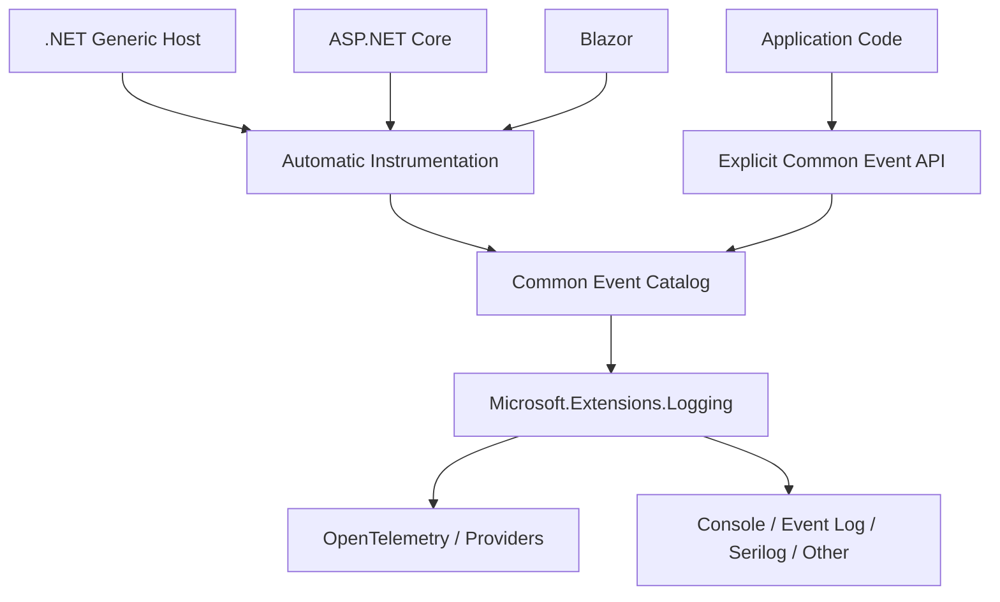
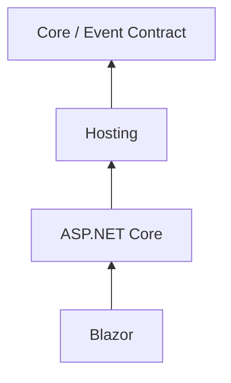

# Architecture

## Context

The library sits between .NET application/framework lifecycle signals and the application's configured telemetry pipeline. It translates known framework conditions and explicit application signals into standardized semantic events.

## Architectural layers

### Event contract

The lowest layer owns stable event definitions: identifier, symbolic name, category, default level, message template, required/optional properties, documentation, and lifecycle status.

It has no dependency on ASP.NET Core or Blazor.

### Hosting instrumentation

Generic Host integration observes host lifecycle signals such as started, stopping, and stopped. This is the common foundation for Worker Services and server-side .NET applications using the Generic Host.

### ASP.NET Core instrumentation

ASP.NET Core integration adds web-host and HTTP-pipeline-aware behavior. It should reuse hosting instrumentation rather than reimplement it.

### Blazor instrumentation

Blazor integration adds Blazor-specific semantics, such as server circuit lifecycle where supported and useful. It builds on ASP.NET Core integration.

### Explicit event API

Applications can emit standardized events whose semantics cannot be inferred safely by framework instrumentation.

## Dependency rule

Dependencies flow from specialized packages toward general packages only.

No core component may reference ASP.NET Core, Blazor, a specific telemetry backend, or a specific logging provider.

## Runtime model

Registration adds narrowly scoped observers, middleware, handlers, or hosted components appropriate to the application type. These components listen to supported framework signals and emit catalog-defined events through `ILogger`.

The library should prefer public, documented .NET extension points. Reflection, runtime patching, fragile event interception, and dependencies on implementation details are out of scope unless a future ADR explicitly justifies them.

## Automatic versus explicit events

| Source | Example | Mode |
| --- | --- | --- |
| Generic Host | Host reached started state | Automatic |
| Generic Host | Host is stopping | Automatic |
| ASP.NET Core | Unhandled request exception observed by library boundary | Automatic where reliable |
| Blazor Server | Circuit opened/closed | Automatic where supported |
| Application | Dependency retry policy exhausted | Explicit unless framework supplies semantic certainty |
| Application | Fallback mode activated | Explicit |
| Application | Domain operation rejected | Explicit/application-defined |

## Failure isolation

Telemetry is a non-functional concern. Failure in Common Application Events must not normally terminate, block, or materially alter the application's functional behavior. Instrumentation components should avoid throwing into application paths and must not create recursive logging failures.

## Performance

The default implementation should avoid expensive enrichment, payload serialization, synchronous I/O, and duplicate telemetry. Message templates should use structured logging patterns and avoid interpolation work when the configured level is disabled.

## Compatibility

Target frameworks and supported .NET versions are an explicit product decision. The initial implementation should prefer currently supported modern .NET versions and avoid unnecessary compatibility abstractions until requirements justify them.
