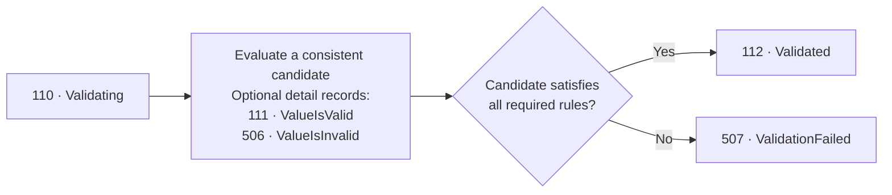

# Configuration validation events

Configuration validation events report an application's evaluation of a
candidate configuration. They do not perform validation, apply configuration,
or change the application's operating mode.

Access these methods through `logger.Configuration` after importing:

```csharp
using Patware.Diagnostics.ApplicationEvents;
```

## Events

| ID | Event | Level | Meaning |
| --- | --- | --- | --- |
| 110 | Configuration_Validating | Information | A validation attempt begins. |
| 111 | Configuration_ValueIsValid | Information | One setting passed its applicable checks. |
| 112 | Configuration_Validated | Information | The candidate passed all required checks. |
| 506 | Configuration_ValueIsInvalid | Warning | A setting failed a validation rule. |
| 507 | Configuration_ValidationFailed | Warning | The attempt concluded that the candidate is invalid. |

See the [Configuration events](../events/Category_Configuration.md) for exact signatures, templates,
arguments, and relationships.

## Expected flow



A completed evaluation emits one aggregate outcome: 112 or 507.
Per-setting detail records are optional and may repeat for different settings.
A setting may produce multiple 506 records for distinct failed rules.

Group-level rules can reject a candidate even when every individually
validated setting passes.

Cancellation, a validator exception, or process termination can leave an
attempt without an aggregate outcome. Do not report 507 solely because the
validator could not complete its work.

## Correlating an attempt

Supply the same `ConfigurationName` and `ValidationId` on every record in
an attempt. Generate a new identifier for each retry or reload.

```csharp
const string configurationName = "ProductService";
string validationId = Guid.NewGuid().ToString("N");

logger.Configuration.Validating(configurationName, validationId);

// Evaluate the actual candidate here.
// Emit optional setting results and exactly one aggregate outcome.
```

Monitoring should correlate records by application instance, configuration
name, and validation identifier. Events from concurrent attempts can interleave.

A missing outcome can indicate an interrupted attempt, but can also result
from filtering or collection loss. Alert deadlines belong to monitoring
configuration rather than to the event emitters.

## Validation, application, and recovery

Event 112 means the declared validation rules passed. It does not mean that
the candidate was applied or that every external dependency is reachable.

Event 507 means the candidate requires correction. An earlier valid
configuration may remain active, so rejection does not automatically imply
application degradation or shutdown.

Likewise, 111 is not automatically recovery from 506. It can describe an
ordinary successful setting check in any attempt.

The application separately decides whether to emit operating-mode events
401 and 204.

## Obtaining a logger

When validation can occur after host construction but before startup,
resolve a logger from the built host:

```csharp
using IHost host = builder.Build();

ILogger logger = host.Services
    .GetRequiredService<ILoggerFactory>()
    .CreateLogger("ConfigurationValidation");

// Validate before calling host.RunAsync().
```

Failures that prevent host construction require an independently configured
bootstrap logger. Do not build an additional service provider merely to
obtain an early logger.

## Sensitive data and filtering

Setting values are deliberately absent from the event signatures.
Names and reasons must also be non-sensitive; the library does not redact
text supplied by the caller.

Normal logging filters apply. A Warning minimum level retains 506 and 507
but suppresses 110, 111, and 112. Monitoring that expects complete sequences
must retain Information-level records for the emitting logger category.

Accessing `logger.Configuration` preserves that logger's category.

## Sample applications

The sample startup blocks demonstrate explicit event emission, including
a rejected attempt followed by a successful attempt. They simulate results;
they do not implement a configuration validator or operator-driven reload.
