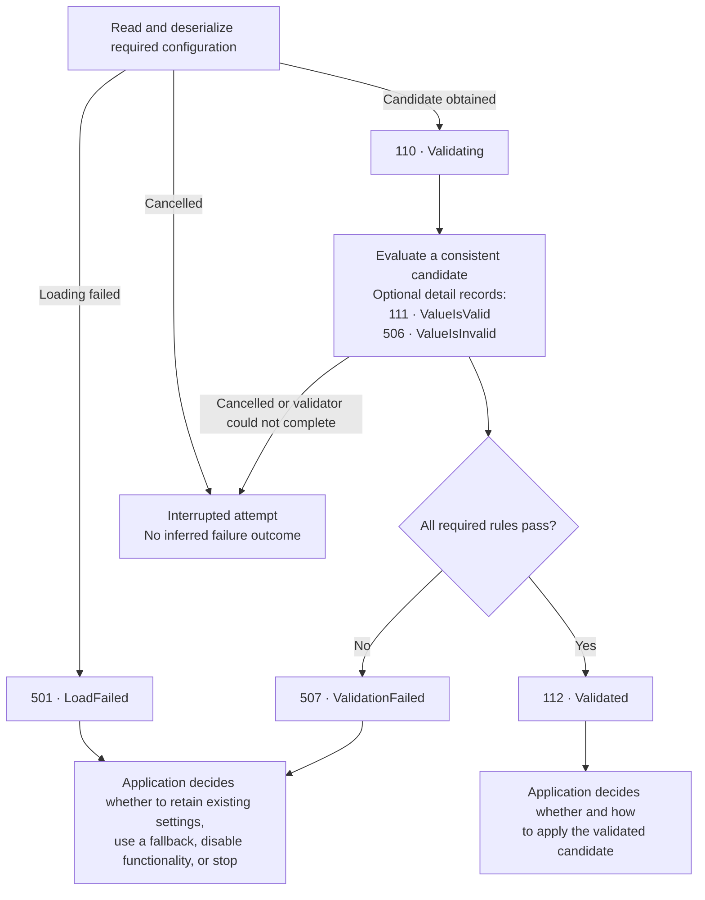

# Configuration loading and validation

Configuration events describe attempts to obtain and evaluate candidate
settings. Loading, validation, and application are separate stages:

- Loading obtains a candidate from a source.
- Validation evaluates the candidate against application rules.
- Application makes accepted settings active.

The event methods report observations. They do not perform these stages,
retain previous settings, or change application mode.

Access the events through `logger.Configuration` after importing:

```csharp
using Patware.Diagnostics.ApplicationEvents;
```

## Events

| ID | Event | Level | Meaning |
|---|---|---|---|
| [110](../events/Event_110.md) | Configuration_Validating | Information | A validation attempt begins. |
| [111](../events/Event_111.md) | Configuration_ValueIsValid | Information | One setting passed its applicable checks. |
| [112](../events/Event_112.md) | Configuration_Validated | Information | The candidate passed all required checks. |
| [501](../events/Event_501.md) | Configuration_LoadFailed | Warning | Loading failed before a candidate could be obtained for validation. |
| [506](../events/Event_506.md) | Configuration_ValueIsInvalid | Warning | A setting failed a validation rule. |
| [507](../events/Event_507.md) | Configuration_ValidationFailed | Warning | Validation concluded that the candidate is invalid. |

See the [Configuration category](../events/Category_Configuration.md) for
exact signatures, message templates, arguments, and catalog relationships.

## Loading and validation flow

This workflow begins with a required configuration-loading attempt.
It distinguishes failure to obtain a candidate from rejection of a candidate
that was successfully loaded.



The diagram illustrates an application workflow. It does not define an
additional mandatory catalog relationship between 501 and 110.

### Loading failure

Emit 501 when a required loading attempt fails during source access,
reading, parsing, or deserialization.

Examples include a missing required source, denied file access, malformed
JSON, or a representation that cannot be deserialized into the candidate type.

A missing optional source is not automatically a loading failure.

If no candidate was obtained, validation need not begin. Do not emit 506 or
507 merely because loading failed.

Cancellation and application shutdown are not configuration-loading failures.

### Validation outcome

Once a candidate is available, emit 110 before evaluating its rules.

A completed evaluation emits exactly one aggregate outcome: 112 or 507.
Per-setting detail records are optional and may repeat for different settings.
A setting may produce multiple 506 records for distinct failed rules.

Group-level rules can reject a candidate even when every individually
validated setting passes.

Cancellation, a validator exception, or process termination can leave an
attempt without an aggregate outcome. Do not report 507 solely because
validation could not complete.

## Correlating attempts

Use a new `LoadId` for each loading attempt, including retries and reloads.
Event 501 includes the logical `ConfigurationName` and `SourceName` together
with that identifier.

Use a new `ValidationId` for each validation attempt. Supply the same
`ConfigurationName` and `ValidationId` on its beginning, detail, and
aggregate-outcome records.

```csharp
const string configurationName = "KeyboardPolling";
string validationId = Guid.NewGuid().ToString("N");

logger.Configuration.Validating(configurationName, validationId);

// Evaluate a consistent candidate.
// Emit optional setting results and exactly one aggregate outcome
// when evaluation concludes.
```

`LoadId` and `ValidationId` identify different phases. Use a logging scope or
trace to connect them when end-to-end reload correlation is needed.
SampleConsole generates separate identifiers without establishing that
additional correlation.

Monitoring should include the application instance and logical configuration
name when correlating records. Concurrent attempts can interleave.

There is currently no standard loading-start or loading-success event.
A 501 record therefore does not require a matching loading-completion record.

Missing validation outcomes can reflect interruption, filtering, collection
loss, or abrupt termination. Alert deadlines belong to monitoring policy.

## Active configuration, application, and recovery

Loading and validation describe candidate attempts. Active configuration
describes the settings the application is currently using.

| Observation | What it establishes | What it does not establish |
|---|---|---|
| 501 | A loading attempt failed before obtaining a candidate. | The application has no working settings. |
| 506 | A setting failed a validation rule. | The whole evaluation has concluded. |
| 507 | Validation concluded that the candidate is invalid. | Existing settings were discarded or the application stopped. |
| 112 | The candidate passed the declared validation rules. | The candidate was applied or its dependencies are healthy. |

A failed reload can retain previously accepted settings. An initial loading
failure can use a valid built-in fallback if application policy permits it.
If no acceptable configuration remains, the application chooses how to
disable functionality or stop.

Applying a candidate is a separate operation. These events do not report
whether replacing the active settings succeeded. Event 112 must not be
treated as proof that the active configuration changed.

A later successful validation does not automatically represent recovery.
Event 111 is not a completion event for 506, and 112 is not a recovery event
for 501.

Emit [401](../events/Event_401.md) only when functionality actually becomes
reduced. Emit [204](../events/Event_204.md) only after an application that
entered degraded mode has restored normal operation.

SampleConsole retains working settings after loading or validation failures,
so those failures do not automatically produce 401 or 204.

## Obtaining a logger

When loading and validation can occur after host construction but before
startup, resolve a logger from the built host:

```csharp
using IHost host = builder.Build();

ILogger logger = host.Services
    .GetRequiredService<ILoggerFactory>()
    .CreateLogger("ConfigurationLoading");

// Load and validate before calling host.RunAsync().
```

Failures that prevent host construction require an independently configured
bootstrap logger. Do not build an additional service provider merely to
obtain an early logger.

SampleConsole loads its separate polling file before `host.StartAsync()`.
Its configuration records can therefore appear before application event 101.

## Sensitive data and filtering

Configuration values are deliberately absent from the event signatures.
Names, source identifiers, and reasons must also be non-sensitive.
The library does not redact caller-supplied text.

A Warning minimum level retains 501, 506, and 507 while suppressing
110, 111, and 112. Monitoring that expects complete validation sequences
must retain Information-level records for the emitting logger category.

Event 501 accepts a nullable exception. The application decides whether
exception details are appropriate for its logging destination.
Exception messages and nested exceptions can expose paths, keys, or source
details.

SampleConsole emits a concise 501 Warning without an exception. It logs the
original exception separately at Debug with the same `LoadId`.

Enable Debug for the sample's `Program` logging category when those details
are needed. This additional record is diagnostic detail, not another
configuration-loading failure event.

Accessing `logger.Configuration` preserves the logger's original category.

## SampleConsole reload demonstration

SampleConsole reads the copied `sample-polling.json` beside its executable.
It prints the exact path at startup. Edit that output file while the
application is running, then press R.

A valid example is:

```json
{
  "PollingIntervalMilliseconds": 250
}
```

The supported interval is 50 through 1000 milliseconds.

| Action, followed by R | Expected events | Active settings |
|---|---|---|
| Save valid JSON with interval 250 | 110 → 111 → 112 | Replaced with 250 ms |
| Empty the file or make its JSON malformed | 501 | Retained |
| Save valid JSON with interval 0 | 110 → 506 → 507 | Retained |
| Rename the required file | 501 with SourceNotFound | Retained |
| Restore valid JSON | 110 → 111 → 112 | Replaced |

The sample starts with a valid built-in 100 ms fallback. If its initial
loading attempt fails, that fallback remains active.

After a successful validation, the sample assigns the candidate to its
active configuration and logs:

> Accepted polling configuration is now active.

That ordinary application log confirms the assignment. Event 112 reports
the preceding validation outcome.

The sample's source classifications are:

| ReasonCode | Meaning |
|---|---|
| SourceNotFound | The required file or its directory was not found. |
| SourceAccessDenied | Access to the source was denied. |
| SourceReadFailed | Another I/O failure prevented reading the source. |
| SourceParseFailed | Parsing or deserialization could not produce a candidate. |

The sample performs reloads sequentially and retains the previous settings
on failure. It does not modify the host's configuration providers or implement
automatic file watching.

Other sample startup blocks demonstrate explicit validation-event emission
using simulated outcomes.
