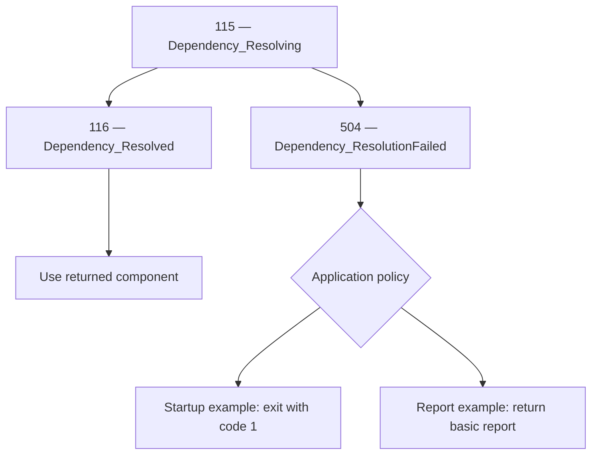

# Dependency resolution

Dependency events describe one attempt to locate, load, or obtain an application
component. The application supplies the dependency name, requesting operation,
and a shared resolution-attempt identifier.

| Event | Level | Meaning |
| --- | --- | --- |
| [115 — Dependency_Resolving](../events/Event_115.md) | Information | An attempt to obtain the requested component is beginning. |
| [116 — Dependency_Resolved](../events/Event_116.md) | Information | The requested component was supplied successfully. |
| [504 — Dependency_ResolutionFailed](../events/Event_504.md) | Warning | The attempt failed to supply the requested component; a reason code and optional exception describe the failure. |

Successful resolution can return an existing instance. It does not imply new
construction, component health, external connectivity, or successful business
operations. An optional lookup returning null does not establish success.

## Registration, validation, and resolution

Service registration describes how a component should be supplied. For example,
`AddSingleton<IService, Service>()` registers an implementation; it does not
construct that implementation. Registration failures are not event 504.

Building the service provider can validate dependency graphs and scope rules.
Container validation failures are a separate phase from the explicit resolution
attempts demonstrated here.

Resolution asks the provider for an instance. `GetRequiredService<T>()` can fail
because a registration is missing, a dependency cannot be supplied, or a
constructor or factory throws. Event 504 describes the failed request; it does
not necessarily identify the innermost component responsible for the failure.

`AddApplicationEvents()` does not automatically intercept dependency injection
resolution attempts. The application explicitly emits these events at the boundary
that owns the attempt. The events also apply to other component-resolution
mechanisms, such as plugin loading.

## Observe the resolution boundary

Keep the `try` block focused on obtaining the component. A failure while using
an already resolved component is not a resolution failure.

The following pattern assumes an existing provider, logger, and application
interface `IFoo`. The logger must already be available independently of the
resolution attempt being observed.

```csharp
string resolutionId = Guid.NewGuid().ToString("N");
IFoo foo;

logger.Dependency.Resolving(
    dependencyName: nameof(IFoo),
    operationName: "ResolveFoo",
    resolutionId: resolutionId);

try
{
    foo = provider.GetRequiredService<IFoo>();
}
catch (Exception ex) when (ex is not OperationCanceledException)
{
    logger.Dependency.ResolutionFailed(
        dependencyName: nameof(IFoo),
        operationName: "ResolveFoo",
        resolutionId: resolutionId,
        reasonCode: "ResolutionThrew",
        exception: null);

    logger.LogDebug(
        ex,
        "Dependency resolution exception details. Resolution: {ResolutionId}.",
        resolutionId);

    throw;
}

logger.Dependency.Resolved(
    dependencyName: nameof(IFoo),
    operationName: "ResolveFoo",
    resolutionId: resolutionId);

// Business operations using foo belong outside the resolution catch.
```

Import `Microsoft.Extensions.DependencyInjection`, `Microsoft.Extensions.Logging`,
and `Patware.Diagnostics.ApplicationEvents` for this pattern.

The catch excludes cancellation. Rethrowing preserves the original failure;
continuing instead requires an explicit application policy, such as the sample's
fallback. Report the attempt once rather than emitting duplicate records at each
calling layer.

Beginning and success logging sit outside the resolution `try` so an exception
from either logging call is not misclassified as a failure to resolve the component.
If a failure handler continues with a fallback, return or otherwise branch away
from the success event. A fallback does not turn the failed original attempt into
a successful resolution.

## Outcomes and filtering

An observed attempt that supplies the component has the sequence 115 → 116.
An observed resolution failure has the sequence 115 → 504. These are alternative
outcomes, not a sequence of all three events. Event methods do not enforce order,
deduplicate records, or emit outcomes automatically.

Cancellation is excluded from the failure catch. Cancellation or process termination
can leave a beginning event without an outcome. Missing 116 or 504 is therefore a
reason to investigate, not proof that the requested component was unavailable.

Logging filters can also hide records: a Warning minimum level excludes Information
events 115 and 116 while retaining 504. Interpret incomplete sequences in the context
of the configured filters and logging delivery.

## Correlation and exception details

Use a new `ResolutionId` for each attempt and preserve it across records for that
attempt. Use the same dependency and operation names for the beginning and outcome.
Use stable logical dependency and operation names rather than sensitive
paths or configuration contents.

`ResolutionThrew` means the resolution call threw without asserting a more
specific cause. Do not classify every `InvalidOperationException` as `NotFound`:
constructors and factories can throw the same exception type. More specific
application-defined codes are appropriate when the cause is established.

The sample passes null to the Warning event and logs the original exception
separately at Debug with the same identifier. Debug details appear only when
enabled by logging configuration. Exceptions can contain sensitive information;
enable them only for appropriate logging destinations. Alternatively, pass the
original exception directly to 504 when suitable. Do not manufacture exceptions
solely for logging.

## SampleConsole walkthrough

Run these commands from the repository root.

### Required component unavailable at startup

```powershell
dotnet run --project ./SampleApplications/SampleConsole -- `
  --Samples:DependencyResolution:FailAtStartup=true
```

This option deliberately skips registration of `IReportFormatterSample`.
Program emits 115 before `GetRequiredService<IReportFormatterSample>()`. The request
fails, emits 504 instead of 116, and exits with code 1. With Warning logging enabled, the failure is
visible even though the host has not started. Application lifecycle events
101–104 are not expected from this path because `host.StartAsync()` is not reached.
Other diagnostics, including configuration-loading records, may precede this attempt.

The option is read once before registration. Restart the application to change
the scenario; configuration reload does not rebuild the service provider.

### Report generation with a fallback

```powershell
dotnet run --project ./SampleApplications/SampleConsole
```

With the option absent or false, `IReportFormatterSample` is registered. Program
emits 115 and then 116 for its successful resolution before starting the host.
The application starts normally. Press **G** to generate a report.

`ReportFormatterSample` requests `IReportFormatter`, which is intentionally
unregistered. It emits 115 and then 504, omits 116, and returns
`Basic report: Sample data`. Each press
performs a new attempt with a new identifier. The sample currently has no
concrete `IReportFormatter` implementation and therefore demonstrates the failed
resolution and fallback, rather than successful formatting through that interface.

With Information logging enabled, expect these dependency sequences:

| Scenario | Sequence | Application policy |
| --- | --- | --- |
| Normal startup | 115 → 116 | Start the host. |
| Startup failure option enabled | 115 → 504 | Exit with code 1 before host startup. |
| Press G after normal startup | 115 → 504 | Return the basic report and continue running. |

## Application policy and related events



The catalog declares the beginning/completion relationship between 115 and 116,
with 504 as the failure outcome. Fallback and shutdown branches illustrate
application policy; they are not additional catalog lifecycle transitions.
These event methods do not resolve components, select a fallback, or stop the application.

Neither sample path automatically emits
[401 — Application_InDegradedMode](../events/Event_401.md). Emit 401 only when
application policy determines that functionality is actually reduced. A later
successful resolution does not automatically justify
[204 — Application_InNormalMode](../events/Event_204.md); that event reports an
actual recovery from degraded mode.

Configuration source loading failures belong to
[501 — Configuration_LoadFailed](../events/Event_501.md). An operation encountering
an unavailable external service belongs to
[602 — External_ServiceUnavailable](../events/Event_602.md).
