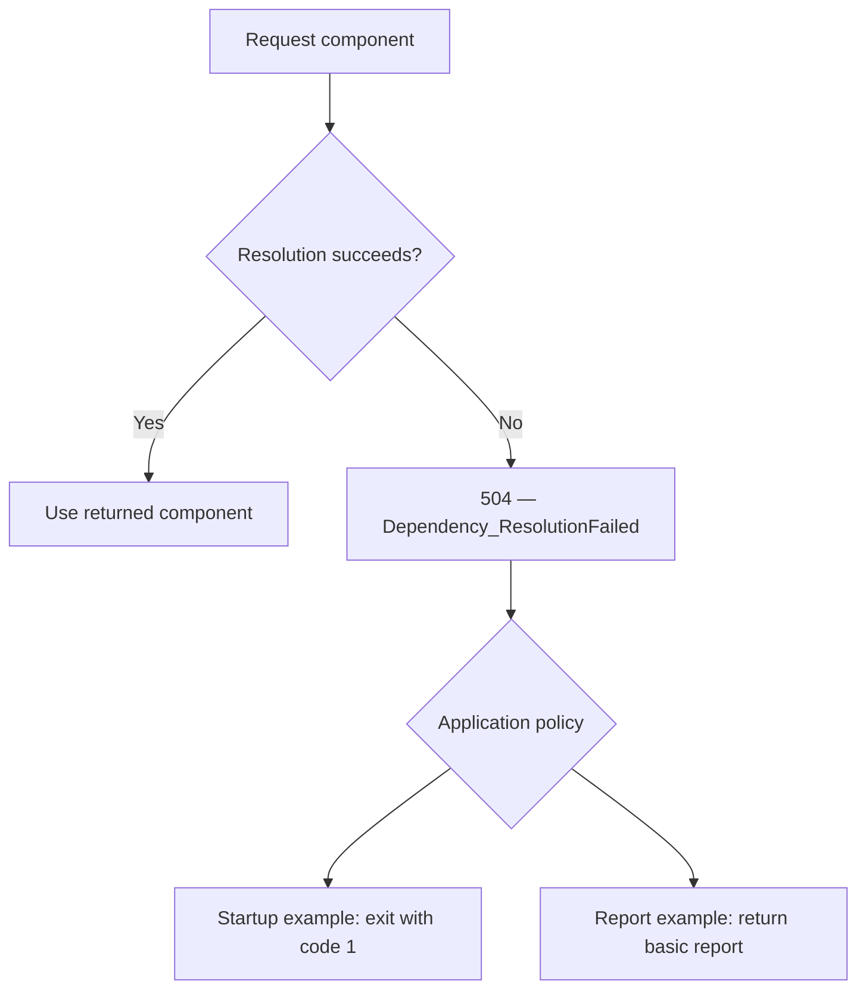

# Dependency resolution

[504 — Dependency_ResolutionFailed](../events/Event_504.md) reports an attempt
to locate, load, or construct an application component that could not supply
the requested component. It is a Warning event with caller-supplied dependency,
operation, resolution-attempt identifier, reason code, and optional exception.

## Registration, validation, and resolution

Service registration describes how a component should be supplied. For example,
`AddSingleton<IService, Service>()` registers an implementation; it does not
construct that implementation. Registration failures are not event 504.

Building the service provider can validate dependency graphs and scope rules.
Container validation failures are a separate phase from the explicit resolution
attempts demonstrated here.

Resolution asks the provider for an instance. `GetRequiredService<T>()` can fail
because a registration is missing, a dependency cannot be supplied, or a
constructor or factory throws. Event 504 describes the failed request; it does
not necessarily identify the innermost component responsible for the failure.

`AddApplicationEvents()` does not automatically intercept dependency injection
resolution failures. The application explicitly emits 504 at the boundary that
owns the attempt. The event also applies to other component-resolution
mechanisms, such as plugin loading.

## Observe the resolution boundary

Keep the `try` block focused on obtaining the component. A failure while using
an already resolved component is not a resolution failure.

The following pattern assumes an existing provider, logger, and application
interface `IFoo`. The logger must already be available independently of the
resolution attempt being observed.

```csharp
string resolutionId = Guid.NewGuid().ToString("N");
IFoo foo;

try
{
    foo = provider.GetRequiredService<IFoo>();
}
catch (Exception ex) when (ex is not OperationCanceledException)
{
    logger.Dependency.ResolutionFailed(
        dependencyName: nameof(IFoo),
        operationName: "ResolveFoo",
        resolutionId: resolutionId,
        reasonCode: "ResolutionThrew",
        exception: null);

    logger.LogDebug(
        ex,
        "Dependency resolution exception details. Resolution: {ResolutionId}.",
        resolutionId);

    throw;
}

// Business operations using foo belong outside the resolution catch.
```

Import `Microsoft.Extensions.DependencyInjection`, `Microsoft.Extensions.Logging`,
and `Patware.Diagnostics.ApplicationEvents` for this pattern.

The catch excludes cancellation. Rethrowing preserves the original failure;
continuing instead requires an explicit application policy, such as the sample's
fallback. Report the attempt once rather than emitting duplicate records at each
calling layer.

## Correlation and exception details

Use a new `ResolutionId` for each attempt and preserve it across records for that
attempt. Use stable logical dependency and operation names rather than sensitive
paths or configuration contents.

`ResolutionThrew` means the resolution call threw without asserting a more
specific cause. Do not classify every `InvalidOperationException` as `NotFound`:
constructors and factories can throw the same exception type. More specific
application-defined codes are appropriate when the cause is established.

The sample passes null to the Warning event and logs the original exception
separately at Debug with the same identifier. Debug details appear only when
enabled by logging configuration. Exceptions can contain sensitive information;
enable them only for appropriate logging destinations. Alternatively, pass the
original exception directly to 504 when suitable. Do not manufacture exceptions
solely for logging.

## SampleConsole walkthrough

Run these commands from the repository root.

### Required component unavailable at startup

```powershell
dotnet run --project ./SampleApplications/SampleConsole -- `
  --Samples:DependencyResolution:FailAtStartup=true
```

This option deliberately skips registration of `IReportFormatterSample`.
Program's subsequent `GetRequiredService<IReportFormatterSample>()` fails,
emits 504, and exits with code 1. With Warning logging enabled, the failure is
visible even though the host has not started. Application lifecycle events
101–104 are not expected from this path because `host.StartAsync()` is not reached.
Other diagnostics, including configuration-loading records, may precede 504.

The option is read once before registration. Restart the application to change
the scenario; configuration reload does not rebuild the service provider.

### Report generation with a fallback

```powershell
dotnet run --project ./SampleApplications/SampleConsole
```

With the option absent or false, `IReportFormatterSample` is registered and the
application starts normally. Press **G** to generate a report.

`ReportFormatterSample` requests `IReportFormatter`, which is intentionally
unregistered. It emits 504 and returns `Basic report: Sample data`. Each press
performs a new attempt with a new identifier. The sample currently has no
concrete `IReportFormatter` implementation and therefore demonstrates the failed
resolution and fallback, rather than successful formatting through that interface.

## Application policy and related events



These are application workflows, not mandatory catalog lifecycle transitions.
Event 504 does not resolve components, select a fallback, or stop the application.

Neither sample path automatically emits
[401 — Application_InDegradedMode](../events/Event_401.md). Emit 401 only when
application policy determines that functionality is actually reduced. A later
successful resolution does not automatically justify
[204 — Application_InNormalMode](../events/Event_204.md); that event reports an
actual recovery from degraded mode.

Configuration source loading failures belong to
[501 — Configuration_LoadFailed](../events/Event_501.md). An operation encountering
an unavailable external service belongs to
[602 — External_ServiceUnavailable](../events/Event_602.md).
