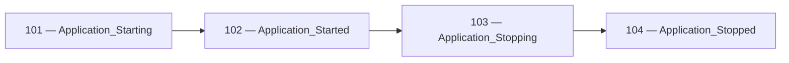
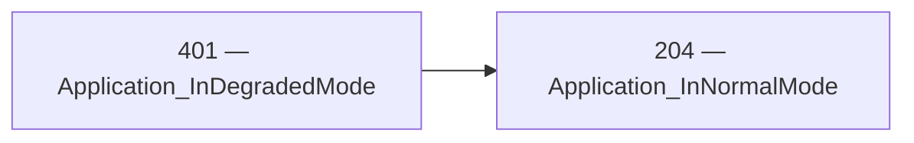

<!-- Generated by Generate-Events.ps1. Do not edit. -->

# Application event catalog

Definitions come from `catalog/ApplicationEvents/events.json`.

Events are grouped through category properties on an existing logger.
Category access preserves the original logger and does not change its
logging category, providers, or configuration.

Import the API namespace:

```csharp
using Patware.Diagnostics.ApplicationEvents;
```

The examples below assume an existing `ILogger` named `logger` and
caller-supplied variables for any event arguments.

Calling an event method emits a record; it does not perform the
application operation or lifecycle transition it describes.

<a id="event-101"></a>

## 101 — Application_Starting

Indicates that application initialization is beginning\.

| Field | Value |
| --- | --- |
| API category | Application |
| Event class | LowLevel |
| Default level | Information |
| Status | Stable |
| Introduced | 0.0.1 |

### Usage

```csharp
logger.Application.Starting();
```

**Trigger:** Emit immediately before beginning application initialization\.

**Message template:** Application is starting\.

### Arguments

None.

### Remarks

- Framework or bootstrap logging may occur before this event; it does not guarantee that it is the first log record in the process\.
- Command\-line arguments are excluded because they may contain sensitive information\.

### Related events

- Corresponding completion: [102 — Application\_Started](#event-102)
- Expected following event in &#39;Application&#39;: [102 — Application\_Started](#event-102)

These relationships describe expected progression for the same application
instance. Other log records may appear between related events. Missing
records can also result from filtering, collection loss, or abrupt termination.


<a id="event-102"></a>

## 102 — Application_Started

Indicates that application initialization completed successfully and the application is ready to begin its intended work\.

| Field | Value |
| --- | --- |
| API category | Application |
| Event class | LowLevel |
| Default level | Information |
| Status | Stable |
| Introduced | 0.0.1 |

### Usage

```csharp
logger.Application.Started(@totalMilliseconds);
```

**Trigger:** Emit after all initialization required for the application to begin its intended work has completed successfully\.

**Message template:** Application is Started\. Elapsed: \{TotalMilliseconds\} milliseconds

### Arguments

- `totalMilliseconds` (`double`): The elapsed time, in milliseconds, from the beginning of application initialization until startup completes\.

### Remarks

- Measure totalMilliseconds from the beginning of initialization represented by Application\_Starting to successful completion represented by this event\.
- The caller supplies the elapsed duration; the logging method does not start or stop a timer\.
- Successful startup does not guarantee that every optional dependency is healthy\.

### Related events

- Corresponding beginning: [101 — Application\_Starting](#event-101)
- Expected preceding event in &#39;Application&#39;: [101 — Application\_Starting](#event-101)
- Expected following event in &#39;Application&#39;: [103 — Application\_Stopping](#event-103)

These relationships describe expected progression for the same application
instance. Other log records may appear between related events. Missing
records can also result from filtering, collection loss, or abrupt termination.


<a id="event-103"></a>

## 103 — Application_Stopping

Indicates that application shutdown is beginning\.

| Field | Value |
| --- | --- |
| API category | Application |
| Event class | LowLevel |
| Default level | Information |
| Status | Stable |
| Introduced | 0.0.1 |

### Usage

```csharp
logger.Application.Stopping(@reason);
```

**Trigger:** Emit when application shutdown begins, before performing shutdown cleanup\.

**Message template:** Application is stopping\. Reason: \{Reason\}

### Arguments

- `reason` (`string`): A non\-sensitive description of the shutdown cause, or &#39;Unknown&#39; when the cause is unavailable\.

### Remarks

- The reason describes the known cause of shutdown\. Use &#39;Unknown&#39; when the cause is unavailable rather than inferring one\.
- This event indicates that shutdown has begun, not that cleanup has completed\.

### Related events

- Corresponding completion: [104 — Application\_Stopped](#event-104)
- Expected preceding event in &#39;Application&#39;: [102 — Application\_Started](#event-102)
- Expected following event in &#39;Application&#39;: [104 — Application\_Stopped](#event-104)

These relationships describe expected progression for the same application
instance. Other log records may appear between related events. Missing
records can also result from filtering, collection loss, or abrupt termination.


<a id="event-104"></a>

## 104 — Application_Stopped

Indicates that application shutdown cleanup has completed\.

| Field | Value |
| --- | --- |
| API category | Application |
| Event class | LowLevel |
| Default level | Information |
| Status | Stable |
| Introduced | 0.0.1 |

### Usage

```csharp
logger.Application.Stopped();
```

**Trigger:** Emit after application shutdown cleanup completes, while logging remains available\.

**Message template:** Application is Stopped

### Arguments

None.

### Remarks

- This event describes completion of application shutdown cleanup; it does not prove that the operating\-system process has exited\.
- Abrupt termination may prevent this event from being emitted\.

### Related events

- Corresponding beginning: [103 — Application\_Stopping](#event-103)
- Expected preceding event in &#39;Application&#39;: [103 — Application\_Stopping](#event-103)

These relationships describe expected progression for the same application
instance. Other log records may appear between related events. Missing
records can also result from filtering, collection loss, or abrupt termination.


<a id="event-110"></a>

## 110 — Configuration_Validating

Indicates that validation of a candidate configuration is beginning\.

| Field | Value |
| --- | --- |
| API category | Configuration |
| Event class | LowLevel |
| Default level | Information |
| Status | Stable |
| Introduced | 0.0.4 |

### Usage

```csharp
logger.Configuration.Validating(@configurationName, @validationId);
```

**Trigger:** Emit immediately before evaluating the candidate against its validation rules\.

**Message template:** Validating configuration \{ConfigurationName\}\. Validation: \{ValidationId\}\.

### Arguments

- `configurationName` (`string`): The non\-sensitive logical name of the configuration being validated\.
- `validationId` (`string`): The unique identifier for this validation attempt, shared by its detail and outcome events\.

### Remarks

- Use a new validation identifier for each attempt, including retries and configuration reloads\.
- A completed evaluation emits exactly one aggregate outcome: Configuration\_Validated or Configuration\_ValidationFailed\.
- Per\-setting results are optional and can appear between the beginning and aggregate outcome\.
- Validate a consistent candidate snapshot so all results describe the same configuration\.
- Cancellation, a validator exception, or process termination can prevent an aggregate outcome\. Absence of an outcome does not prove the candidate is invalid\.
- Calling this method only emits a record; it does not perform validation or enforce event ordering\.

### Related events

- Corresponding completion: [112 — Configuration\_Validated](#event-112)
- Possible failure outcome: [507 — Configuration\_ValidationFailed](#event-507)

These relationships describe expected progression for the same application
instance. Other log records may appear between related events. Missing
records can also result from filtering, collection loss, or abrupt termination.


<a id="event-111"></a>

## 111 — Configuration_ValueIsValid

Indicates that a setting passed all checks applicable to that setting in this attempt\.

| Field | Value |
| --- | --- |
| API category | Configuration |
| Event class | LowLevel |
| Default level | Information |
| Status | Stable |
| Introduced | 0.0.4 |

### Usage

```csharp
logger.Configuration.ValueIsValid(@configurationName, @validationId, @settingName);
```

**Trigger:** Optionally emit after the setting passes its applicable validation checks\.

**Message template:** Setting \{SettingName\} in configuration \{ConfigurationName\} passed validation\. Validation: \{ValidationId\}\.

### Arguments

- `configurationName` (`string`): The logical configuration name used by the beginning event\.
- `validationId` (`string`): The identifier of the validation attempt containing this result\.
- `settingName` (`string`): The non\-sensitive name or relative path of the validated setting\.

### Remarks

- A valid setting does not establish that the entire configuration is valid\.
- Emit at most one success result for a setting in an attempt, after its applicable checks complete\.
- A successful check of one rule is insufficient if another applicable rule fails\.
- This event can describe ordinary validation success and does not necessarily indicate recovery from an earlier failure\.
- The setting value is intentionally excluded because configuration can contain sensitive information\.


<a id="event-112"></a>

## 112 — Configuration_Validated

Indicates that a candidate configuration passed all required validation checks\.

| Field | Value |
| --- | --- |
| API category | Configuration |
| Event class | LowLevel |
| Default level | Information |
| Status | Stable |
| Introduced | 0.0.4 |

### Usage

```csharp
logger.Configuration.Validated(@configurationName, @validationId);
```

**Trigger:** Emit once when the completed evaluation establishes that the candidate satisfies all required validation rules\.

**Message template:** Configuration \{ConfigurationName\} passed validation\. Validation: \{ValidationId\}\.

### Arguments

- `configurationName` (`string`): The logical configuration name used by the beginning event\.
- `validationId` (`string`): The identifier of the successfully completed validation attempt\.

### Remarks

- Use the same configuration name and validation identifier as Configuration\_Validating\.
- Do not emit this event merely because validation finished; a rejected candidate produces Configuration\_ValidationFailed\.
- Success is defined by the declared rules\. It does not establish external connectivity unless connectivity was explicitly checked\.
- This event does not indicate that the candidate has been applied or that application degradation has cleared\.
- Per\-setting success records may be omitted without changing the meaning of this aggregate result\.

### Related events

- Corresponding beginning: [110 — Configuration\_Validating](#event-110)

These relationships describe expected progression for the same application
instance. Other log records may appear between related events. Missing
records can also result from filtering, collection loss, or abrupt termination.


<a id="event-204"></a>

## 204 — Application_InNormalMode

Indicates that the application has recovered from degraded operation\.

| Field | Value |
| --- | --- |
| API category | Application |
| Event class | OperationalInformation |
| Default level | Information |
| Status | Stable |
| Introduced | 0.0.3 |

### Usage

```csharp
logger.Application.InNormalMode();
```

**Trigger:** Emit when the application leaves degraded mode after all conditions causing reduced functionality have cleared\.

**Message template:** Application has returned to normal operation\.

### Arguments

None.

### Remarks

- This event describes recovery of the application instance as a whole\. Recovery of one dependency is insufficient if another condition still leaves the application degraded\.
- Use Application\_Started for successful startup; do not emit this event merely because startup completed\.
- Emit once per transition back to normal operation rather than on every successful health check\.
- Calling this method only emits a diagnostic record\. It does not change application state, deduplicate calls, or verify recovery\.
- This event does not establish that a load balancer has resumed routing traffic to this instance\.
- The corresponding degraded\-mode event is 401, Application\_InDegradedMode\.

### Related events

- Expected preceding event in &#39;Application recovery&#39;: [401 — Application\_InDegradedMode](#event-401)

These relationships describe expected progression for the same application
instance. Other log records may appear between related events. Missing
records can also result from filtering, collection loss, or abrupt termination.


<a id="event-401"></a>

## 401 — Application_InDegradedMode

Indicates that a recoverable problem has reduced application functionality while allowing operation to continue\.

| Field | Value |
| --- | --- |
| API category | Application |
| Event class | RecoverableWarning |
| Default level | Warning |
| Status | Stable |
| Introduced | 0.0.3 |

### Usage

```csharp
logger.Application.InDegradedMode(@reason);
```

**Trigger:** Emit when the application first establishes degraded operation or transitions from normal to degraded operation\.

**Message template:** Application is operating in degraded mode\. Reason: \{Reason\}

### Arguments

- `reason` (`string`): A non\-sensitive description of the condition and its effect on application functionality\.

### Remarks

- Examples include serving cached data or temporarily disabling an optional feature while a dependency is unavailable\.
- A failed dependency check alone is insufficient: the application must determine that its functionality is reduced\.
- Emit once when entering degraded mode rather than repeatedly while the condition persists\. The application owns transition detection\.
- Planned maintenance, deployment draining, and intentional traffic withdrawal do not by themselves constitute degraded operation\.
- Describe the operational impact without including credentials, connection strings, configuration values, or personal data\.
- Calling this method only emits a diagnostic record\. It does not activate a fallback, change readiness, throttle traffic, or initiate recovery\.
- Emit 204, Application\_InNormalMode, when all conditions causing degraded operation have cleared\.

### Related events

- Expected following event in &#39;Application recovery&#39;: [204 — Application\_InNormalMode](#event-204)

These relationships describe expected progression for the same application
instance. Other log records may appear between related events. Missing
records can also result from filtering, collection loss, or abrupt termination.


<a id="event-506"></a>

## 506 — Configuration_ValueIsInvalid

Indicates that a candidate configuration setting failed a validation rule\.

| Field | Value |
| --- | --- |
| API category | Configuration |
| Event class | UnrecoverableWarning |
| Default level | Warning |
| Status | Stable |
| Introduced | 0.0.4 |

### Usage

```csharp
logger.Configuration.ValueIsInvalid(@configurationName, @validationId, @settingName, @reason);
```

**Trigger:** Optionally emit when evaluation establishes that a setting violates an applicable validation rule\.

**Message template:** Setting \{SettingName\} in configuration \{ConfigurationName\} failed validation\. Reason: \{Reason\}\. Validation: \{ValidationId\}\.

### Arguments

- `configurationName` (`string`): The logical configuration name used by the beginning event\.
- `validationId` (`string`): The identifier of the validation attempt containing this result\.
- `settingName` (`string`): The non\-sensitive name or relative path of the invalid setting\.
- `reason` (`string`): A non\-sensitive description of the failed rule and the correction required\.

### Remarks

- Multiple failure details may describe distinct failed rules for the same setting\.
- The candidate requires correction, but an earlier valid configuration may remain active\.
- Do not include setting values, credentials, connection strings, or personal data in the reason\.
- Do not treat an interrupted or unavailable validator as proof that a setting is invalid\.
- This detail record does not complete the attempt; the aggregate rejection is Configuration\_ValidationFailed\.
- This event does not automatically imply application degradation or require shutdown\.


<a id="event-507"></a>

## 507 — Configuration_ValidationFailed

Indicates that validation concluded that a candidate configuration is invalid\.

| Field | Value |
| --- | --- |
| API category | Configuration |
| Event class | UnrecoverableWarning |
| Default level | Warning |
| Status | Stable |
| Introduced | 0.0.4 |

### Usage

```csharp
logger.Configuration.ValidationFailed(@configurationName, @validationId, @reason);
```

**Trigger:** Emit once when an evaluation rejects the candidate because one or more required validation rules failed\.

**Message template:** Configuration \{ConfigurationName\} failed validation\. Reason: \{Reason\}\. Validation: \{ValidationId\}\.

### Arguments

- `configurationName` (`string`): The logical configuration name used by the beginning event\.
- `validationId` (`string`): The identifier of the validation attempt that rejected the candidate\.
- `reason` (`string`): A non\-sensitive summary of why the candidate failed validation\.

### Remarks

- Use the same configuration name and validation identifier as Configuration\_Validating\.
- Fail\-fast validation may conclude rejection without evaluating every remaining rule\.
- Group\-level or cross\-setting rules can fail even when every individually validated setting is valid\.
- The candidate requires correction\. This event does not establish that the application has no usable configuration\.
- The application decides whether to retain an earlier configuration, disable a feature, or stop\.
- Cancellation or a validator exception alone does not establish an invalid candidate and must not be reported using this event\.
- Do not include configuration values or sensitive exception messages in the reason\.
- Calling this method only emits a record; it does not reject or apply configuration\.

### Related events

- Beginning associated with this failure: [110 — Configuration\_Validating](#event-110)

These relationships describe expected progression for the same application
instance. Other log records may appear between related events. Missing
records can also result from filtering, collection loss, or abrupt termination.


<a id="event-601"></a>

## 601 — External_OperationTimedOut

Reports an external operation attempt that failed to complete within its timeout budget\.

| Field | Value |
| --- | --- |
| API category | External |
| Event class | Exceptional |
| Default level | Error |
| Status | Stable |
| Introduced | 0.0.5 |

### Usage

```csharp
logger.External.OperationTimedOut(@externalName, @operationName, @operationId, @timeoutMilliseconds, @exception);
```

**Trigger:** Emit when the caller establishes that an external operation attempt timed out\.

**Message template:** External operation timed out\. Dependency: \{ExternalName\}\. Operation: \{OperationName\}\. Attempt: \{OperationId\}\. Timeout: \{TimeoutMilliseconds\} milliseconds\.

### Arguments

- `externalName` (`string`): The stable logical name of the external dependency, without credentials or request\-specific data\.
- `operationName` (`string`): The stable logical name of the operation that timed out\.
- `operationId` (`string`): The identifier of this individual operation attempt\. Use a different identifier for each retry\.
- `timeoutMilliseconds` (`double`): The configured timeout budget for this attempt, in milliseconds, rather than its measured elapsed duration\.
- `exception` (`Exception`): The original exception associated with the confirmed timeout\.

### Remarks

- An operation can time out while establishing a connection or while awaiting the result of an already connected operation\.
- Cancellation alone does not establish a timeout\. Do not emit this event for user cancellation or application shutdown\.
- An OperationCanceledException is appropriate when the caller has established that the operation&#39;s timeout caused cancellation\.
- The exception is required even when Error logging is disabled\. Pass the original exception through the logging exception channel rather than converting it to a message\-template property\.
- Emit once per failed attempt at the boundary responsible for reporting the dependency operation\. Avoid logging the same timeout again at each layer\.
- OperationId identifies an individual attempt\. A higher\-level scope or trace can correlate several attempts belonging to the same logical operation\.
- TimeoutMilliseconds describes the configured budget, not measured elapsed time\. Cancellation observation and cleanup can occur after that budget expires\.
- A timeout establishes that the caller did not obtain a result within its budget\. It does not establish that the remote operation stopped or that it produced no side effects\.
- This event reports a failed operation attempt\. It does not establish that the dependency is permanently unavailable or that administrator intervention is immediately required\.
- Emit Application\_InDegradedMode separately only when application functionality becomes reduced\. Emit Application\_InNormalMode only when the application subsequently recovers from that degradation\.
- Calling this method only emits a diagnostic record\. It does not cancel operations, retry requests, manage a circuit breaker, or change application state\.


<a id="event-602"></a>

## 602 — External_ServiceUnavailable

Reports that an external dependency could not serve an operation because of an observed availability failure\.

| Field | Value |
| --- | --- |
| API category | External |
| Event class | Exceptional |
| Default level | Error |
| Status | Stable |
| Introduced | 0.0.6 |

### Usage

```csharp
logger.External.ServiceUnavailable(@externalName, @operationName, @operationId, @reasonCode, @exception);
```

**Trigger:** Emit when the caller receives an explicit unavailable result or establishes that a dependency exception represents an availability failure\.

**Message template:** External service unavailable\. Dependency: \{ExternalName\}\. Operation: \{OperationName\}\. Attempt: \{OperationId\}\. Reason: \{ReasonCode\}\.

### Arguments

- `externalName` (`string`): The stable logical name of the dependency, without credentials or request\-specific data\.
- `operationName` (`string`): The stable logical name of the operation the dependency could not serve\.
- `operationId` (`string`): The identifier of this individual operation attempt\. Use a different identifier for each retry\.
- `reasonCode` (`string`): A stable application\-defined classification of the observed availability failure, such as ServiceUnavailable\. Do not include response bodies or exception messages\.
- `exception` (`Exception?`): The original exception associated with the availability failure, or null when the dependency returned an unavailable result without throwing\.

### Remarks

- This event describes availability from the caller&#39;s perspective for one operation attempt\. It does not establish that the service is unavailable to every caller\.
- Use OperationTimedOut for an operation that exceeded its timeout budget\. Do not emit both events merely to describe the same timeout\.
- Do not classify every unsuccessful response or exception as service unavailability\. Authentication, authorization, invalid requests, and business rejections have different meanings\.
- A locally open circuit breaker does not establish the dependency&#39;s current availability because the operation was not attempted\.
- ReasonCode is an application\-defined classification suitable for grouping and alerting\. Use a small documented set of values rather than request\-specific text\.
- Pass the original exception when one exists\. Pass null for an unavailable result returned without an exception; do not manufacture an exception solely for logging\.
- The exception travels through the logging exception channel and is not a message\-template property\.
- Emit once per failed attempt at the boundary responsible for reporting the dependency operation\. Use a higher\-level scope or trace to correlate retries\.
- A failed attempt does not automatically change application mode\. Emit Application\_InDegradedMode separately when functionality becomes reduced and Application\_InNormalMode after recovery\.
- User cancellation and application shutdown are not availability failures\.
- Calling this method only emits a diagnostic record\. It does not retry requests, operate a circuit breaker, or change application state\.


<a id="event-701"></a>

## 701 — Application_UnhandledException

Reports an unrecoverable exception at an application boundary\.

| Field | Value |
| --- | --- |
| API category | Application |
| Event class | Catastrophic |
| Default level | Critical |
| Status | Stable |
| Introduced | 0.0.2 |

### Usage

```csharp
logger.Application.UnhandledException(@exception);
```

**Trigger:** Emit when an exception reaches a top\-level application boundary and the application cannot continue normally\.

**Message template:** Application encountered an unrecoverable exception\.

### Arguments

- `exception` (`Exception`): The exception that reached the application boundary and prevents normal operation from continuing\.

### Remarks

- This event is intended for application\-ending failures, not recoverable operation or request failures\.
- Unhandled means that lower\-level application code did not recover from the exception; a top\-level boundary may catch it to report the failure and initiate shutdown\.
- Pass the original exception so logging providers retain access to its type, stack trace, and inner exceptions\.
- The exception travels through the logging exception channel and is not a message\-template property\.
- The exception argument must not be null, even when Critical logging is disabled\.
- Calling this method only emits a diagnostic record\. It does not terminate the process, initiate shutdown, or install exception handlers\.
- Abrupt termination may prevent this event from being emitted or flushed\.


## Related transitions

- Beginning: 101 — Application_Starting
  - Completion: 102 — Application_Started
  - No failure event is currently associated with this pair.

- Beginning: 103 — Application_Stopping
  - Completion: 104 — Application_Stopped
  - No failure event is currently associated with this pair.

- Beginning: 110 — Configuration_Validating
  - Completion: 112 — Configuration_Validated
  - Failure: 507 — Configuration_ValidationFailed

## Lifecycle sequences

Sequences describe expected progression, not a guarantee that every
record will be emitted or retained.

### Application



- 101 — Application_Starting
- 102 — Application_Started
- 103 — Application_Stopping
- 104 — Application_Stopped

### Application recovery



- 401 — Application_InDegradedMode
- 204 — Application_InNormalMode
