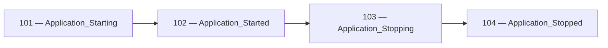
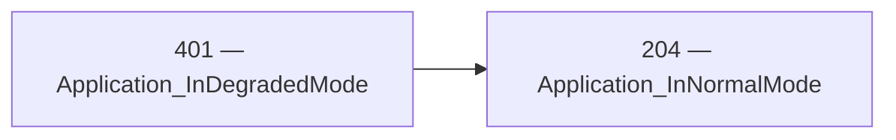

<!-- Generated by Generate-Events.ps1. Do not edit. -->

# Application event catalog

Definitions come from `catalog/ApplicationEvents/events.json`.

Events are grouped through category properties on an existing logger.
Category access preserves the original logger and does not change its
logging category, providers, or configuration.

Import the API namespace:

```csharp
using Patware.Diagnostics.ApplicationEvents;
```

The examples below assume an existing `ILogger` named `logger` and
caller-supplied variables for any event arguments.

Calling an event method emits a record; it does not perform the
application operation or lifecycle transition it describes.

<a id="event-101"></a>

## 101 — Application_Starting

Indicates that application initialization is beginning\.

| Field | Value |
| --- | --- |
| API category | Application |
| Event class | LowLevel |
| Default level | Information |
| Status | Stable |
| Introduced | 0.0.1 |

### Usage

```csharp
logger.Application.Starting();
```

**Trigger:** Emit immediately before beginning application initialization\.

**Message template:** Application is starting\.

### Arguments

None.

### Remarks

- Framework or bootstrap logging may occur before this event; it does not guarantee that it is the first log record in the process\.
- Command\-line arguments are excluded because they may contain sensitive information\.

### Related events

- Corresponding completion: [102 — Application\_Started](#event-102)
- Expected following event in &#39;Application&#39;: [102 — Application\_Started](#event-102)

These relationships describe expected progression for the same application
instance. Other log records may appear between related events. Missing
records can also result from filtering, collection loss, or abrupt termination.


<a id="event-102"></a>

## 102 — Application_Started

Indicates that application initialization completed successfully and the application is ready to begin its intended work\.

| Field | Value |
| --- | --- |
| API category | Application |
| Event class | LowLevel |
| Default level | Information |
| Status | Stable |
| Introduced | 0.0.1 |

### Usage

```csharp
logger.Application.Started(@totalMilliseconds);
```

**Trigger:** Emit after all initialization required for the application to begin its intended work has completed successfully\.

**Message template:** Application is Started\. Elapsed: \{TotalMilliseconds\} milliseconds

### Arguments

- `totalMilliseconds` (`double`): The elapsed time, in milliseconds, from the beginning of application initialization until startup completes\.

### Remarks

- Measure totalMilliseconds from the beginning of initialization represented by Application\_Starting to successful completion represented by this event\.
- The caller supplies the elapsed duration; the logging method does not start or stop a timer\.
- Successful startup does not guarantee that every optional dependency is healthy\.

### Related events

- Corresponding beginning: [101 — Application\_Starting](#event-101)
- Expected preceding event in &#39;Application&#39;: [101 — Application\_Starting](#event-101)
- Expected following event in &#39;Application&#39;: [103 — Application\_Stopping](#event-103)

These relationships describe expected progression for the same application
instance. Other log records may appear between related events. Missing
records can also result from filtering, collection loss, or abrupt termination.


<a id="event-103"></a>

## 103 — Application_Stopping

Indicates that application shutdown is beginning\.

| Field | Value |
| --- | --- |
| API category | Application |
| Event class | LowLevel |
| Default level | Information |
| Status | Stable |
| Introduced | 0.0.1 |

### Usage

```csharp
logger.Application.Stopping(@reason);
```

**Trigger:** Emit when application shutdown begins, before performing shutdown cleanup\.

**Message template:** Application is stopping\. Reason: \{Reason\}

### Arguments

- `reason` (`string`): A non\-sensitive description of the shutdown cause, or &#39;Unknown&#39; when the cause is unavailable\.

### Remarks

- The reason describes the known cause of shutdown\. Use &#39;Unknown&#39; when the cause is unavailable rather than inferring one\.
- This event indicates that shutdown has begun, not that cleanup has completed\.

### Related events

- Corresponding completion: [104 — Application\_Stopped](#event-104)
- Expected preceding event in &#39;Application&#39;: [102 — Application\_Started](#event-102)
- Expected following event in &#39;Application&#39;: [104 — Application\_Stopped](#event-104)

These relationships describe expected progression for the same application
instance. Other log records may appear between related events. Missing
records can also result from filtering, collection loss, or abrupt termination.


<a id="event-104"></a>

## 104 — Application_Stopped

Indicates that application shutdown cleanup has completed\.

| Field | Value |
| --- | --- |
| API category | Application |
| Event class | LowLevel |
| Default level | Information |
| Status | Stable |
| Introduced | 0.0.1 |

### Usage

```csharp
logger.Application.Stopped();
```

**Trigger:** Emit after application shutdown cleanup completes, while logging remains available\.

**Message template:** Application is Stopped

### Arguments

None.

### Remarks

- This event describes completion of application shutdown cleanup; it does not prove that the operating\-system process has exited\.
- Abrupt termination may prevent this event from being emitted\.

### Related events

- Corresponding beginning: [103 — Application\_Stopping](#event-103)
- Expected preceding event in &#39;Application&#39;: [103 — Application\_Stopping](#event-103)

These relationships describe expected progression for the same application
instance. Other log records may appear between related events. Missing
records can also result from filtering, collection loss, or abrupt termination.


<a id="event-204"></a>

## 204 — Application_InNormalMode

Indicates that the application has recovered from degraded operation\.

| Field | Value |
| --- | --- |
| API category | Application |
| Event class | OperationalInformation |
| Default level | Information |
| Status | Stable |
| Introduced | 0.0.3 |

### Usage

```csharp
logger.Application.InNormalMode();
```

**Trigger:** Emit when the application leaves degraded mode after all conditions causing reduced functionality have cleared\.

**Message template:** Application has returned to normal operation\.

### Arguments

None.

### Remarks

- This event describes recovery of the application instance as a whole\. Recovery of one dependency is insufficient if another condition still leaves the application degraded\.
- Use Application\_Started for successful startup; do not emit this event merely because startup completed\.
- Emit once per transition back to normal operation rather than on every successful health check\.
- Calling this method only emits a diagnostic record\. It does not change application state, deduplicate calls, or verify recovery\.
- This event does not establish that a load balancer has resumed routing traffic to this instance\.
- The corresponding degraded\-mode event is 401, Application\_InDegradedMode\.

### Related events

- Expected preceding event in &#39;Application recovery&#39;: [401 — Application\_InDegradedMode](#event-401)

These relationships describe expected progression for the same application
instance. Other log records may appear between related events. Missing
records can also result from filtering, collection loss, or abrupt termination.


<a id="event-401"></a>

## 401 — Application_InDegradedMode

Indicates that a recoverable problem has reduced application functionality while allowing operation to continue\.

| Field | Value |
| --- | --- |
| API category | Application |
| Event class | RecoverableWarning |
| Default level | Warning |
| Status | Stable |
| Introduced | 0.0.3 |

### Usage

```csharp
logger.Application.InDegradedMode(@reason);
```

**Trigger:** Emit when the application first establishes degraded operation or transitions from normal to degraded operation\.

**Message template:** Application is operating in degraded mode\. Reason: \{Reason\}

### Arguments

- `reason` (`string`): A non\-sensitive description of the condition and its effect on application functionality\.

### Remarks

- Examples include serving cached data or temporarily disabling an optional feature while a dependency is unavailable\.
- A failed dependency check alone is insufficient: the application must determine that its functionality is reduced\.
- Emit once when entering degraded mode rather than repeatedly while the condition persists\. The application owns transition detection\.
- Planned maintenance, deployment draining, and intentional traffic withdrawal do not by themselves constitute degraded operation\.
- Describe the operational impact without including credentials, connection strings, configuration values, or personal data\.
- Calling this method only emits a diagnostic record\. It does not activate a fallback, change readiness, throttle traffic, or initiate recovery\.
- Emit 204, Application\_InNormalMode, when all conditions causing degraded operation have cleared\.

### Related events

- Expected following event in &#39;Application recovery&#39;: [204 — Application\_InNormalMode](#event-204)

These relationships describe expected progression for the same application
instance. Other log records may appear between related events. Missing
records can also result from filtering, collection loss, or abrupt termination.


<a id="event-701"></a>

## 701 — Application_UnhandledException

Reports an unrecoverable exception at an application boundary\.

| Field | Value |
| --- | --- |
| API category | Application |
| Event class | Catastrophic |
| Default level | Critical |
| Status | Stable |
| Introduced | 0.0.2 |

### Usage

```csharp
logger.Application.UnhandledException(@exception);
```

**Trigger:** Emit when an exception reaches a top\-level application boundary and the application cannot continue normally\.

**Message template:** Application encountered an unrecoverable exception\.

### Arguments

- `exception` (`Exception`): The exception that reached the application boundary and prevents normal operation from continuing\.

### Remarks

- This event is intended for application\-ending failures, not recoverable operation or request failures\.
- Unhandled means that lower\-level application code did not recover from the exception; a top\-level boundary may catch it to report the failure and initiate shutdown\.
- Pass the original exception so logging providers retain access to its type, stack trace, and inner exceptions\.
- The exception travels through the logging exception channel and is not a message\-template property\.
- The exception argument must not be null, even when Critical logging is disabled\.
- Calling this method only emits a diagnostic record\. It does not terminate the process, initiate shutdown, or install exception handlers\.
- Abrupt termination may prevent this event from being emitted or flushed\.


## Related transitions

- Beginning: 101 — Application_Starting
  - Completion: 102 — Application_Started
  - No failure event is currently associated with this pair.

- Beginning: 103 — Application_Stopping
  - Completion: 104 — Application_Stopped
  - No failure event is currently associated with this pair.

## Lifecycle sequences

Sequences describe expected progression, not a guarantee that every
record will be emitted or retained.

### Application



- 101 — Application_Starting
- 102 — Application_Started
- 103 — Application_Stopping
- 104 — Application_Stopped

### Application recovery



- 401 — Application_InDegradedMode
- 204 — Application_InNormalMode
