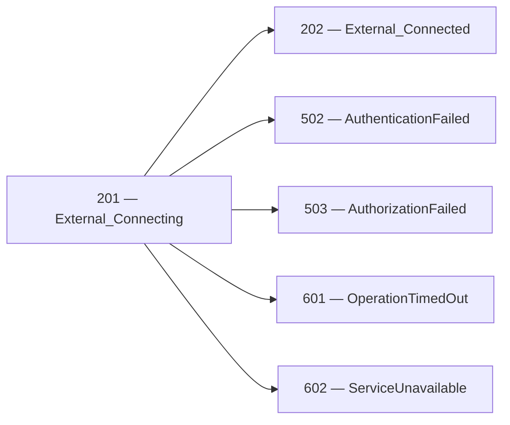
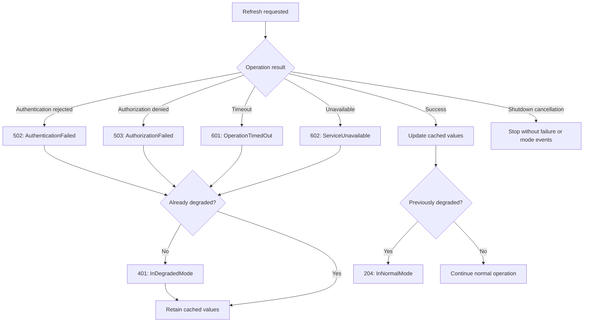

# External operation events

External events describe explicit connection attempts and individual operation
failures. Applications emit these records at the boundary responsible for the
attempt; registration of ApplicationEvents does not automatically instrument
every dependency client.

| Event                               | Meaning                                                                                                   |
|-------------------------------------|-----------------------------------------------------------------------------------------------------------|
| [201 — External_Connecting](../events/Event_201.md) | An explicit connection establishment or acquisition attempt is beginning. |
| [202 — External_Connected](../events/Event_202.md) | The connection API reported successful establishment or acquisition. |
| 502 — External_AuthenticationFailed | The dependency rejected authentication for the attempt.                                                   |
| 503 — External_AuthorizationFailed  | The dependency denied permission for the operation.                                                       |
| 601 — External_OperationTimedOut    | The operation exceeded its timeout budget.                                                                |
| 602 — External_ServiceUnavailable   | The caller observed that the dependency could not serve the operation because of an availability failure. |

User cancellation and application shutdown are neither timeouts nor
availability failures.

Do not emit both 601 and 602 merely to describe the same timeout. Event 602
does not establish that the dependency is unavailable to every caller.

## Structured properties

| Property            | Events             | Meaning                                                       |
|---------------------|--------------------|---------------------------------------------------------------|
| ExternalName        | 201, 202, 502, 503, 601, 602 | Stable logical dependency name.                               |
| OperationName       | 201, 202, 502, 503, 601, 602 | Stable logical operation name.                                |
| OperationId         | 201, 202, 502, 503, 601, 602 | Identifier of one attempt; retries use different identifiers. |
| TimeoutMilliseconds | 601                | Configured timeout budget, not measured elapsed time.         |
| ReasonCode          | 502, 503, 602      | Stable application-defined failure classification.            |

The four failure events use the logging exception channel. Events 201 and 202
have no exception argument.

Event 601 requires the original timeout exception. Events 502, 503, and 602
accept null for normal failure results. For authentication and authorization
failures, exception messages and nested details must also be appropriate for
the logging destination. Do not manufacture an exception solely for logging.

These event identifiers are library identifiers, not HTTP status codes.
Classify outcomes from the dependency contract rather than matching the
event number to a protocol status number.

Use a logging scope or trace to associate several attempts with a larger
logical operation.

## Connection establishment versus operations

Emit 201 immediately before invoking an API whose purpose is to establish or
acquire a connection. Emit 202 immediately after that API reports success,
before performing subsequent business operations. Use the same external name,
operation name, and operation identifier for the beginning and outcome.

Define success according to the API being observed: for example, opening a
transport connection, establishing an authenticated session, or acquiring an
open database connection from a pool. Acquiring a pooled connection does not
prove that a new physical connection was created. A transport connection alone
does not prove application authentication or authorization.

An ordinary HTTP request or a call through an existing connection does not by
itself establish an explicit connection boundary. Do not emit 201/202 simply
because a dependency operation started and returned successfully.

Keep connection establishment inside its own `try` block. Place beginning
logging before that block and success logging after its failure handler, so
logging exceptions are not misclassified as connection failures. Failure
handlers must rethrow, return, or otherwise branch away from the success event.
Business operations belong outside the connection catch: a failed command
after connection success is not failure to establish that connection.



Failure branches apply only when the connection attempt establishes that
outcome. Events 502, 503, 601, and 602 can also describe other external
operations without a preceding 201. These branches are not an exhaustive
classification of every possible connection error; do not relabel an unrelated
exception as service unavailability.

Cancellation, process termination, or an unclassified failure can leave 201
without a corresponding catalog outcome. Missing 202 does not by itself prove
unavailability. Logging filters and delivery also affect the visible sequence:
201/202 use Information, so a Warning minimum level excludes them while
retaining the applicable Warning and Error failure events.

Successful connection establishment does not guarantee future operation success
or continued connection availability. It does not automatically justify
[204 — Application_InNormalMode](../events/Event_204.md). Application mode
transitions remain separate decisions based on actual functionality and recovery.

## Connection observation helper

`ConnectExternalAsync` is an opt-in Core extension on `ILogger`. It wraps only
the connection delegate, supplying a cancellation token and emitting correlated
201/202 records. It returns a `Task`, not an operation identifier or connection.
Import `Patware.Diagnostics.ApplicationEvents` to use it.

This example assumes an existing logger, validated endpoint, and application
shutdown token:

```csharp
using System.Net.WebSockets;
using Patware.Diagnostics.ApplicationEvents;

using ClientWebSocket socket = new();
string operationId = Guid.NewGuid().ToString("N");

await logger.ConnectExternalAsync(
    externalName: "WebSocketEcho",
    operationName: "OpenWebSocket",
    timeout: TimeSpan.FromSeconds(10),
    connectAsync: token => socket.ConnectAsync(endpoint, token),
    cancellationToken: shutdownToken,
    operationId: operationId);

// Business operations and graceful connection cleanup belong here.
```

Omitting `operationId`, or passing null, generates an identifier for the attempt.
Supply one before invocation when caller failure or cleanup diagnostics must use
the same `OperationId`. Use a fresh identifier for every retry. The helper rejects
empty or whitespace identifiers.

The delegate must pass its supplied token to the connection API. The positive,
finite timeout requests cancellation; it cannot forcibly stop code that ignores
the token. Normal delegate completion is treated as success, even if cancellation
was requested but ignored. The helper does not abandon a still-running delegate.

| Outcome | Helper behavior |
| --- | --- |
| Delegate completes successfully | Emit 202 after 201. |
| Delegate throws cancellation after the deadline, without caller cancellation | Emit 601 with the configured budget and original exception, then rethrow. |
| Caller cancellation | Propagate cancellation without 601; an already-canceled call emits no beginning event. |
| Other delegate exception | Propagate unchanged without inferred 502, 503, or 602. |

When both caller cancellation and the deadline have been requested, caller
cancellation takes precedence in timeout classification. The helper does not
convert timeout cancellation into `TimeoutException`.

Do not also emit manual 201/202 around the same attempt. Logging filters control
records, not execution or timeout behavior. Logging-provider exceptions are not
suppressed. The application retains ownership of connection resources, cleanup,
failure classification, retries, user messages, fallback, and application mode.

## SampleConsole WebSocket demonstration

Run from the repository root:

```powershell
dotnet run --project ./SampleApplications/SampleConsole
```

Press **E** for the optional Echo connection demonstration. The default endpoint
is `wss://ws.postman-echo.com/raw`. No connection is attempted until E is pressed.
The demonstration establishes a WebSocket handshake and then closes the connection;
it does not send a message or receive an echo. Event 202 confirms the handshake.

Override the endpoint at startup when using another server:

```powershell
dotnet run --project ./SampleApplications/SampleConsole -- `
  --Samples:WebSocket:Endpoint=ws://localhost:5000/echo
```

The override assumes a WebSocket server is listening at the selected address;
SampleConsole does not start one. The default public endpoint requires internet
access and may be unavailable or blocked by local network policy. Automated tests
must not depend on that endpoint.

At startup, the `WebSocketEcho` configuration is validated once:

| Configuration | Events | Sample policy |
| --- | --- | --- |
| Absolute ws:// or wss:// URI with a host | 110 → 111 → 112 | Accept the endpoint for subsequent E commands. |
| Invalid endpoint | 110 → 506 → 507 | Disable Echo attempts and retain the other sample features. |
| Setting absent | Validate the built-in default | No configuration loading failure. |

Validation establishes the declared URI rules, not DNS resolution, connectivity,
or remote service health. The raw setting value is not included in validation
events. Restart the application to change the accepted endpoint.

Each E command creates a new client and operation identifier. Connection success
produces 201 → 202. A cooperative connection deadline produces 201 → 601. Other
WebSocket failures are handled by the sample without assuming a specific catalog
classification. Exception details are available at Debug where configured.

The connection budget is ten seconds. Cleanup has a separate three-second budget;
cleanup failures do not invalidate 202 or become connection failure events. The
console awaits this demonstration, temporarily pausing keyboard commands. Ctrl+C
still requests host shutdown and cancels the connection or cleanup. The example
does not emit application-mode changes.

## Cached fallback example

These samples simulate operation results through `SimulatedProductService.FetchAsync`,
not connection establishment. They do not emit 201/202 around a refresh. Their
failure and recovery flows remain independent of the connection relationship above.

The samples provide five dependency modes:

| Mode                   | Outcome                                                    |
|------------------------|------------------------------------------------------------|
| Available              | Returns fresh values.                                      |
| Unresponsive           | Waits until timeout; emits 601.                            |
| Unavailable            | Immediately reports unavailability; emits 602.             |
| AuthenticationRejected | Immediately rejects application authentication; emits 502. |
| AuthorizationDenied    | Immediately denies the operation; emits 503.               |

The Worker checks persistent switches in this order:

1. `authentication-failed.txt`
2. `authorization-denied.txt`
3. `unavailable.txt`
4. `degraded.txt`

The first existing switch selects the request behavior. Remove all four
switches to allow recovery. Paths are relative to the current working
directory and are logged at startup. Changes affect subsequent requests.



The authentication and authorization simulations represent the application
calling its dependency. Cached fallback demonstrates continued use of
application-owned sample prices.

Real applications must apply their own authorization and data-access policy
to cached data. A dependency rejection does not authorize serving protected
data from a cache.

Changing between failure kinds does not establish recovery and does not
repeat event 401. A successful refresh establishes recovery and emits 204.

## Interpretation

A timeout means the caller did not obtain a result within its budget.
It does not prove that the remote operation stopped or had no side effects.

Events 502/503 use Warning; events 601/602 use Error. Alerting decisions
should consider persistence, frequency, dependency importance,
and application impact.

Report the failure once at the boundary responsible for the dependency
operation. Avoid reporting the same failure again at each calling layer.

These event methods only emit diagnostic records. They do not establish
connections or implement timeouts, retries, caching, circuit breakers, or
application mode changes. The separately named `ConnectExternalAsync` helper
explicitly orchestrates observation and cooperative timeout cancellation.

Authentication failures, authorization failures, invalid requests, business
rejections, and local circuit-breaker rejections must not automatically
be classified as service unavailability.

The samples use these reason codes:

| Event | ReasonCode |
|---|---|
| 502 — AuthenticationFailed | `AuthenticationRejected` |
| 503 — AuthorizationFailed | `PermissionDenied` |
| 602 — ServiceUnavailable | `ServiceUnavailable` |

Applications should document a small stable vocabulary for any additional
reason codes.

Switching from timeout failures to unavailable results does not establish
recovery. The application remains degraded until a successful refresh.

See the catalog entries for [201 — Connecting](../events/Event_201.md),
[202 — Connected](../events/Event_202.md),
[502 — AuthenticationFailed](../events/Event_502.md),
[503 — AuthorizationFailed](../events/Event_503.md),
[601 — OperationTimedOut](../events/Event_601.md), and
[602 — ServiceUnavailable](../events/Event_602.md) for the complete contracts.

## External call observation helper

`RunExternalAsync` observes an explicitly supplied external operation.
It emits 203 before invocation and 214 when the delegate returns normally.
It returns the original value without interpreting business success.

```csharp
IReadOnlyList<ProductPrice> products = await logger.RunExternalAsync(
    token => SimulatedProductService.FetchAsync(mode, token),
    externalName: "ProductService",
    operationName: "FetchPrice",
    operationId: operationId,
    timeout: TimeSpan.FromSeconds(2),
    cancellationToken: stoppingToken);
```

This example assumes an existing logger, captured simulation mode,
attempt identifier, and application shutdown token.

Only the delegate is required. The dependency name defaults to
`UnspecifiedExternal`; the operation name defaults to the calling member.
Supply explicit names when stable dependency identification matters.

An omitted timeout adds no deadline. A supplied timeout requests cooperative
cancellation through the delegate's token. The tokenless overload cannot
pass that token into the dependency.

Deadline cancellation emits 601 and rethrows the original exception.
Caller cancellation does not emit 601. Other exceptions propagate without
automatic authentication, authorization, or availability classification.

The sample applications recognize their own simulated exceptions and emit
502, 503, or 602 at the application boundary. They retain responsibility
for cache preservation and application-mode transitions.

Do not manually duplicate 203, 214, or the helper's timeout event around
the same attempt. Logging filters do not disable operation execution.

## Shared sample simulation

The Blazor, Worker Service, and WPF samples use the non-packable
SampleApplications.Shared project for simulated dependency behavior,
product data, and explicit operation results.

The shared project has no dependency on Patware.Diagnostics. It does not
emit events, manage caches, impose timeouts, or track application mode.

Each application retains its controls, cancellation policy, cached fallback,
and event emission. This keeps the diagnostic flow visible in each sample
while ensuring that simulated dependency behavior is consistent.

Unavailable results are distinct from successful responses containing no
products. Timeout and shutdown cancellation continue to propagate to the
calling application for classification.
