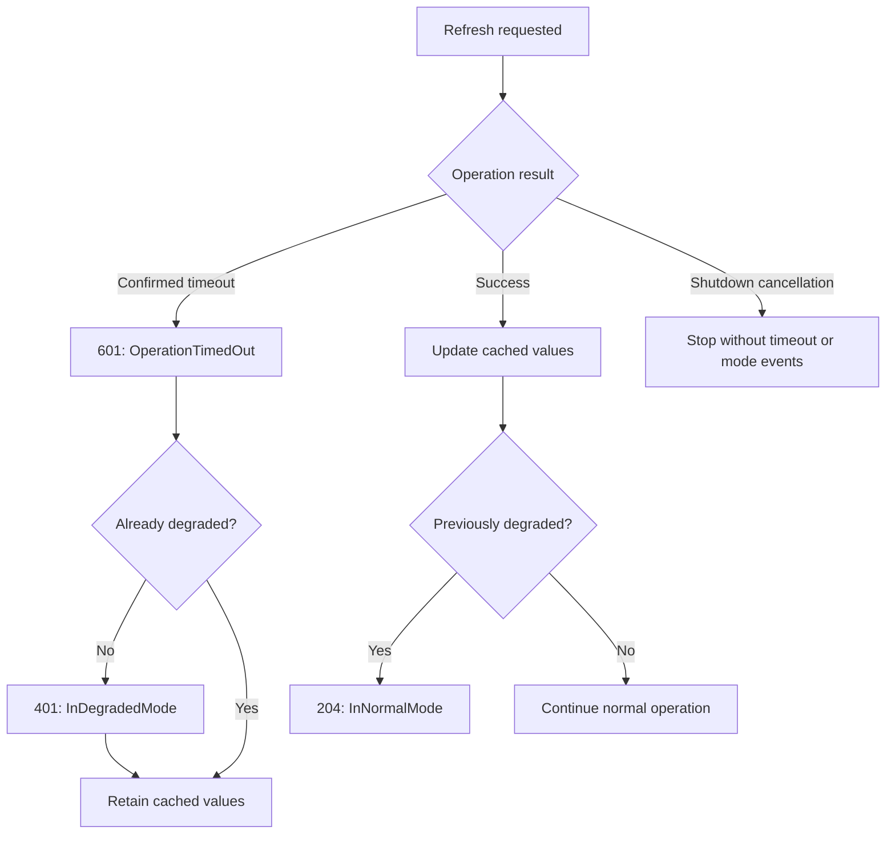

# External operation events

Event 601, `External_OperationTimedOut`, reports an individual external
operation attempt that failed to complete within its timeout budget.

The caller must establish that a timeout occurred. User cancellation and
application shutdown are not dependency timeouts.

## Structured properties

| Property | Meaning |
|---|---|
| ExternalName | Stable logical dependency name. |
| OperationName | Stable logical operation name. |
| OperationId | Identifier of one attempt; retries use different identifiers. |
| TimeoutMilliseconds | Configured timeout budget, not measured elapsed time. |

The original exception is passed through the logging exception channel.
It is not a message-template property.

Use a logging scope or trace to associate several attempts with a larger
logical operation.

## Cached fallback example

The sample applications simulate an unavailable product service by waiting
until the request's timeout cancels the operation.

This diagram describes the samples' fallback policy. It is not a universal
event lifecycle. An operation timeout does not automatically imply reduced
application functionality.

Repeated failed refreshes produce repeated 601 events with distinct attempt
identifiers. Event 401 occurs once on entry into degraded mode. Event 204
occurs after a successful refresh restores normal operation.

If no successful refresh has occurred yet, the cache is empty. Reporting
degraded mode does not imply that fallback data exists.

## Interpretation

A timeout means the caller did not obtain a result within its budget.
It does not prove that the remote operation stopped or had no side effects.

Error severity describes the failed attempt. Alerting decisions should
consider persistence, frequency, dependency importance, and application
impact.

Report the timeout once at the boundary responsible for the dependency
operation. Avoid reporting the same failure again at each calling layer.

These event methods only emit diagnostic records. They do not implement
timeouts, retries, caching, circuit breakers, or application mode changes.

See [the event catalog](EVENT-CATALOG.md#event-601) for the complete contract.
