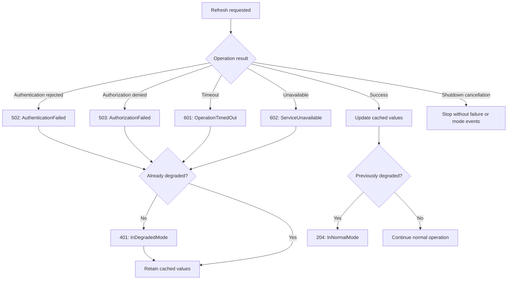

# External operation events

External operation events report individual failed attempts.

| Event                               | Meaning                                                                                                   |
|-------------------------------------|-----------------------------------------------------------------------------------------------------------|
| 502 — External_AuthenticationFailed | The dependency rejected authentication for the attempt.                                                   |
| 503 — External_AuthorizationFailed  | The dependency denied permission for the operation.                                                       |
| 601 — External_OperationTimedOut    | The operation exceeded its timeout budget.                                                                |
| 602 — External_ServiceUnavailable   | The caller observed that the dependency could not serve the operation because of an availability failure. |

User cancellation and application shutdown are neither timeouts nor
availability failures.

Do not emit both events merely to describe the same timeout. Event 602
does not establish that the dependency is unavailable to every caller.

## Structured properties

| Property            | Events             | Meaning                                                       |
|---------------------|--------------------|---------------------------------------------------------------|
| ExternalName        | 502, 503, 601, 602 | Stable logical dependency name.                               |
| OperationName       | 502, 503, 601, 602 | Stable logical operation name.                                |
| OperationId         | 502, 503, 601, 602 | Identifier of one attempt; retries use different identifiers. |
| TimeoutMilliseconds | 601                | Configured timeout budget, not measured elapsed time.         |
| ReasonCode          | 502, 503, 602      | Stable application-defined failure classification.            |

All four events use the logging exception channel.

Event 601 requires the original timeout exception. Events 502, 503, and 602
accept null for normal failure results. For authentication and authorization
failures, exception messages and nested details must also be appropriate for
the logging destination. Do not manufacture an exception solely for logging.

These event identifiers are library identifiers, not HTTP status codes.
Classify outcomes from the dependency contract rather than matching the
event number to a protocol status number.

Use a logging scope or trace to associate several attempts with a larger
logical operation.

## Cached fallback example

The samples provide five dependency modes:

| Mode                   | Outcome                                                    |
|------------------------|------------------------------------------------------------|
| Available              | Returns fresh values.                                      |
| Unresponsive           | Waits until timeout; emits 601.                            |
| Unavailable            | Immediately reports unavailability; emits 602.             |
| AuthenticationRejected | Immediately rejects application authentication; emits 502. |
| AuthorizationDenied    | Immediately denies the operation; emits 503.               |

The Worker checks persistent switches in this order:

1. `authentication-failed.txt`
2. `authorization-denied.txt`
3. `unavailable.txt`
4. `degraded.txt`

The first existing switch selects the request behavior. Remove all four
switches to allow recovery. Paths are relative to the current working
directory and are logged at startup. Changes affect subsequent requests.

The authentication and authorization simulations represent the application
calling its dependency. Cached fallback demonstrates continued use of
application-owned sample prices.

Real applications must apply their own authorization and data-access policy
to cached data. A dependency rejection does not authorize serving protected
data from a cache.

Changing between failure kinds does not establish recovery and does not
repeat event 401. A successful refresh establishes recovery and emits 204.

## Interpretation

A timeout means the caller did not obtain a result within its budget.
It does not prove that the remote operation stopped or had no side effects.

Events 502/503 use Warning; events 601/602 use Error. Alerting decisions
should consider persistence, frequency, dependency importance,
and application impact. Alerting decisions should consider persistence,
frequency, dependency importance, and application impact.

Report the failure once at the boundary responsible for the dependency
operation. Avoid reporting the same failure again at each calling layer.

These event methods only emit diagnostic records. They do not implement
timeouts, retries, caching, circuit breakers, or application mode changes.

Authentication failures, authorization failures, invalid requests, business
rejections, and local circuit-breaker rejections must not automatically
be classified as service unavailability.

The samples use these reason codes:

| Event | ReasonCode |
|---|---|
| 502 — AuthenticationFailed | `AuthenticationRejected` |
| 503 — AuthorizationFailed | `PermissionDenied` |
| 602 — ServiceUnavailable | `ServiceUnavailable` |

Applications should document a small stable vocabulary for any additional
reason codes.

Switching from timeout failures to unavailable results does not establish
recovery. The application remains degraded until a successful refresh.

See the catalog entries for [502 — AuthenticationFailed](EVENT-CATALOG.md#event-502),
[503 — AuthorizationFailed](EVENT-CATALOG.md#event-503),
[601 — OperationTimedOut](EVENT-CATALOG.md#event-601), and
[602 — ServiceUnavailable](EVENT-CATALOG.md#event-602) for the complete contracts.

## Shared sample simulation

The Blazor, Worker Service, and WPF samples use the non-packable
SampleApplications.Shared project for simulated dependency behavior,
product data, and explicit operation results.

The shared project has no dependency on Patware.Diagnostics. It does not
emit events, manage caches, impose timeouts, or track application mode.

Each application retains its controls, cancellation policy, cached fallback,
and event emission. This keeps the diagnostic flow visible in each sample
while ensuring that simulated dependency behavior is consistent.

Unavailable results are distinct from successful responses containing no
products. Timeout and shutdown cancellation continue to propagate to the
calling application for classification.
