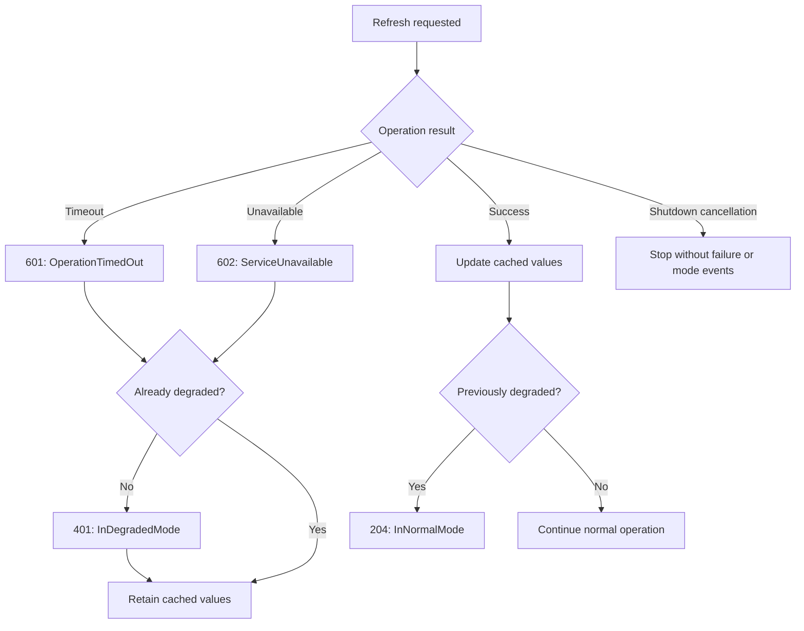

# External operation events

External operation events report individual failed attempts.

| Event | Meaning |
|---|---|
| 601 — External_OperationTimedOut | The operation exceeded its timeout budget. |
| 602 — External_ServiceUnavailable | The caller observed that the dependency could not serve the operation because of an availability failure. |

User cancellation and application shutdown are neither timeouts nor
availability failures.

Do not emit both events merely to describe the same timeout. Event 602
does not establish that the dependency is unavailable to every caller.

## Structured properties

| Property | Events | Meaning |
|---|---|---|
| ExternalName | 601, 602 | Stable logical dependency name. |
| OperationName | 601, 602 | Stable logical operation name. |
| OperationId | 601, 602 | Identifier of one attempt; retries use different identifiers. |
| TimeoutMilliseconds | 601 | Configured timeout budget, not measured elapsed time. |
| ReasonCode | 602 | Stable application-defined availability-failure classification. |

Both events use the logging exception channel rather than an exception
message-template property. Event 601 requires the original timeout
exception. Event 602 accepts null when unavailability was returned as a
normal result. Do not manufacture an exception solely for logging.

Use a logging scope or trace to associate several attempts with a larger
logical operation.

## Cached fallback example

The samples provide three dependency modes: Available returns fresh values,
Unresponsive waits until timeout and produces 601, and Unavailable returns
immediately and produces 602.

In the Worker sample, `degraded.txt` selects Unresponsive and `unavailable.txt`
selects Unavailable. The unavailable switch takes precedence when both
files exist. Remove both files to allow recovery. Paths are resolved against
the current working directory and logged at startup. Changes affect subsequent
requests rather than an already pending request.

This diagram describes the samples' fallback policy. It is not a universal
event lifecycle. An operation failure does not automatically imply reduced
application functionality.

Repeated failed refreshes produce 601 or 602 events according to the observed
failure, with distinct attempt identifiers. Event 401 occurs once on entry
into degraded mode. Event 204
occurs after a successful refresh restores normal operation.

If no successful refresh has occurred yet, the cache is empty. Reporting
degraded mode does not imply that fallback data exists.

## Interpretation

A timeout means the caller did not obtain a result within its budget.
It does not prove that the remote operation stopped or had no side effects.

Error severity describes the failed attempt. Alerting decisions should
consider persistence, frequency, dependency importance, and application
impact.

Report the failure once at the boundary responsible for the dependency
operation. Avoid reporting the same failure again at each calling layer.

These event methods only emit diagnostic records. They do not implement
timeouts, retries, caching, circuit breakers, or application mode changes.

Authentication failures, authorization failures, invalid requests, business
rejections, and local circuit-breaker rejections must not automatically
be classified as service unavailability.

The samples use `ServiceUnavailable` as their reason code. Applications
should document a small stable vocabulary for any additional reason codes.

Switching from timeout failures to unavailable results does not establish
recovery. The application remains degraded until a successful refresh.

See the catalog entries for [601 — OperationTimedOut](EVENT-CATALOG.md#event-601)
and [602 — ServiceUnavailable](EVENT-CATALOG.md#event-602) for the complete contracts.

## Shared sample simulation

The Blazor, Worker Service, and WPF samples use the non-packable
SampleApplications.Shared project for simulated dependency behavior,
product data, and explicit operation results.

The shared project has no dependency on Patware.Diagnostics. It does not
emit events, manage caches, impose timeouts, or track application mode.

Each application retains its controls, cancellation policy, cached fallback,
and event emission. This keeps the diagnostic flow visible in each sample
while ensuring that simulated dependency behavior is consistent.

Unavailable results are distinct from successful responses containing no
products. Timeout and shutdown cancellation continue to propagate to the
calling application for classification.
