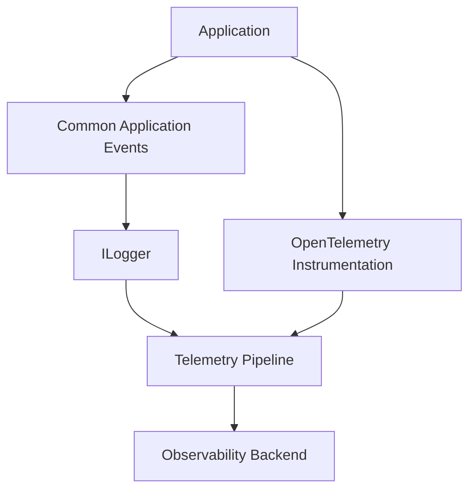

# Observability

## Position in the observability stack

Common Application Events standardizes semantic operational events. It complements the three common observability signals—logs, traces, and metrics—rather than replacing them.



## Logging abstraction

`Microsoft.Extensions.Logging` is the primary logging abstraction. The library should use structured message templates and `EventId` consistently. It should not own log sinks, files, rotation, transport, or retention.

## OpenTelemetry

OpenTelemetry is a natural downstream integration because modern .NET logging can participate in OpenTelemetry pipelines. Where appropriate, Common Event properties should align with established OpenTelemetry semantic conventions rather than create conflicting terminology.

The project should not create custom tracing or metrics conventions merely for symmetry. Add those signals only when they provide independent value.

## Correlation

Events emitted within an active `Activity` should naturally retain the logging provider's trace/span correlation where supported. The library should avoid manually manufacturing correlation identifiers when standard .NET/OpenTelemetry context already exists.

## Operational contract

Monitoring should be able to query stable fields such as event ID/name and structured properties rather than parse message text. This enables reusable rules such as:

```text
EventName == "DependencyUnavailable"
```

or aggregations by application, environment, dependency type, or other available resource attributes.

## Event messages

Human-readable messages remain essential for local development and troubleshooting. Message wording may evolve cautiously, but monitoring rules should depend on stable event identity and structured fields, not prose.

## Logs versus metrics

Do not emit repetitive log events solely to count something. A metric may be the correct signal for rates, latency distributions, queue depth, resource consumption, and other continuously measured values.

## Logs versus traces

Do not create Common Events for every method call or dependency invocation. Distributed traces already model causal request/dependency flow. Common Events should identify operationally meaningful state or outcomes.

## Alerting

The catalog may document likely operational significance, but the library should not prescribe universal alerts. Alert thresholds and routing depend on application criticality, environment, SLOs, redundancy, and organizational practices.
