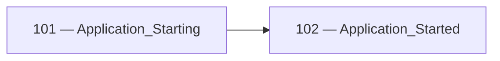
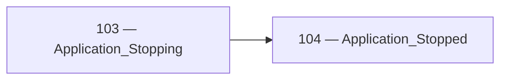
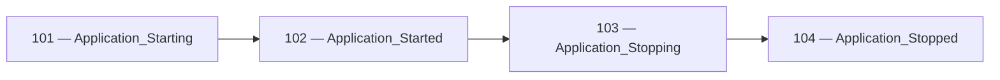
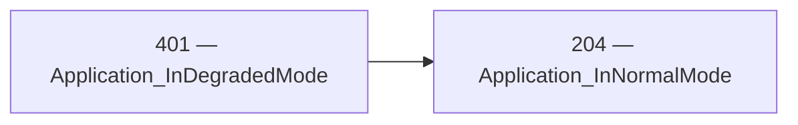

<!-- Generated by Generate-Events.ps1. Do not edit. -->

# Application events

Events that are related to the lifetime of the application, like starting, pausing, stopped\. A typical app&#39;s lifecycle will be: Starting \-&gt; Started \[\-&gt; Pausing \-&gt; Paused \[\-&gt; Resuming \-&gt; Resumed\]\] \-&gt; Stopping \-&gt; Stopped\.

[All events](index.md) · [Category API reference](xref:Patware.Diagnostics.ApplicationEvents.ApplicationEvents)

## Events

| EventId | Category | Method | EventClass | LogLevel |
| --- | --- | --- | --- | --- |
| [101](Event_101.md) | [Application](Category_Application.md) · [API](xref:Patware.Diagnostics.ApplicationEvents.ApplicationEvents) | [Starting](xref:Patware.Diagnostics.ApplicationEvents.ApplicationEvents.Starting) | LowLevel | Information |
| [102](Event_102.md) | [Application](Category_Application.md) · [API](xref:Patware.Diagnostics.ApplicationEvents.ApplicationEvents) | [Started](xref:Patware.Diagnostics.ApplicationEvents.ApplicationEvents.Started%28System.Double%29) | LowLevel | Information |
| [103](Event_103.md) | [Application](Category_Application.md) · [API](xref:Patware.Diagnostics.ApplicationEvents.ApplicationEvents) | [Stopping](xref:Patware.Diagnostics.ApplicationEvents.ApplicationEvents.Stopping%28System.String%29) | LowLevel | Information |
| [104](Event_104.md) | [Application](Category_Application.md) · [API](xref:Patware.Diagnostics.ApplicationEvents.ApplicationEvents) | [Stopped](xref:Patware.Diagnostics.ApplicationEvents.ApplicationEvents.Stopped) | LowLevel | Information |
| [204](Event_204.md) | [Application](Category_Application.md) · [API](xref:Patware.Diagnostics.ApplicationEvents.ApplicationEvents) | [InNormalMode](xref:Patware.Diagnostics.ApplicationEvents.ApplicationEvents.InNormalMode) | OperationalInformation | Information |
| [401](Event_401.md) | [Application](Category_Application.md) · [API](xref:Patware.Diagnostics.ApplicationEvents.ApplicationEvents) | [InDegradedMode](xref:Patware.Diagnostics.ApplicationEvents.ApplicationEvents.InDegradedMode%28System.String%29) | RecoverableWarning | Warning |
| [701](Event_701.md) | [Application](Category_Application.md) · [API](xref:Patware.Diagnostics.ApplicationEvents.ApplicationEvents) | [UnhandledException](xref:Patware.Diagnostics.ApplicationEvents.ApplicationEvents.UnhandledException%28System.Exception%29) | Catastrophic | Critical |

## Related transitions

### 101 — 102

- Beginning: [101 — Application\_Starting](Event_101.md) · [API](xref:Patware.Diagnostics.ApplicationEvents.ApplicationEvents.Starting)
- Completion: [102 — Application\_Started](Event_102.md) · [API](xref:Patware.Diagnostics.ApplicationEvents.ApplicationEvents.Started%28System.Double%29)
- No failure event is currently associated with this pair.

### 103 — 104

- Beginning: [103 — Application\_Stopping](Event_103.md) · [API](xref:Patware.Diagnostics.ApplicationEvents.ApplicationEvents.Stopping%28System.String%29)
- Completion: [104 — Application\_Stopped](Event_104.md) · [API](xref:Patware.Diagnostics.ApplicationEvents.ApplicationEvents.Stopped)
- No failure event is currently associated with this pair.

## Lifecycle sequences

### Application

- [101 — Application\_Starting](Event_101.md) · [API](xref:Patware.Diagnostics.ApplicationEvents.ApplicationEvents.Starting)
- [102 — Application\_Started](Event_102.md) · [API](xref:Patware.Diagnostics.ApplicationEvents.ApplicationEvents.Started%28System.Double%29)
- [103 — Application\_Stopping](Event_103.md) · [API](xref:Patware.Diagnostics.ApplicationEvents.ApplicationEvents.Stopping%28System.String%29)
- [104 — Application\_Stopped](Event_104.md) · [API](xref:Patware.Diagnostics.ApplicationEvents.ApplicationEvents.Stopped)

### Application recovery

- [401 — Application\_InDegradedMode](Event_401.md) · [API](xref:Patware.Diagnostics.ApplicationEvents.ApplicationEvents.InDegradedMode%28System.String%29)
- [204 — Application\_InNormalMode](Event_204.md) · [API](xref:Patware.Diagnostics.ApplicationEvents.ApplicationEvents.InNormalMode)

Complete relationships are shown when any participating event belongs to this
category. Events from other categories remain visible to preserve the flow.
Sequences describe expected progression, not a guarantee that every record
will be emitted or retained.
