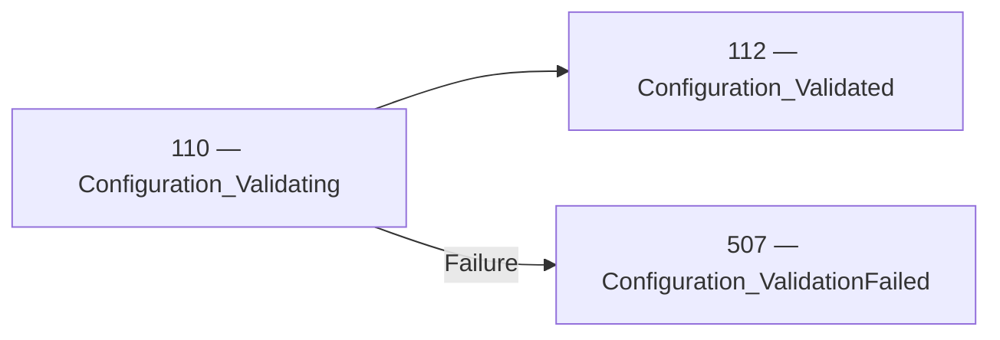

<!-- Generated by Generate-Events.ps1. Do not edit. -->

# Configuration events

Reports validation of candidate configurations and their individual settings\. Successful validation does not imply that a candidate has been applied\.

[All events](index.md) · [Category API reference](xref:Patware.Diagnostics.ApplicationEvents.ConfigurationEvents)

## Events

| EventId | Category | Method | EventClass | LogLevel |
| --- | --- | --- | --- | --- |
| [110](Event_110.md) | [Configuration](Category_Configuration.md) · [API](xref:Patware.Diagnostics.ApplicationEvents.ConfigurationEvents) | [Validating](xref:Patware.Diagnostics.ApplicationEvents.ConfigurationEvents.Validating%28System.String%2CSystem.String%29) | LowLevel | Information |
| [111](Event_111.md) | [Configuration](Category_Configuration.md) · [API](xref:Patware.Diagnostics.ApplicationEvents.ConfigurationEvents) | [ValueIsValid](xref:Patware.Diagnostics.ApplicationEvents.ConfigurationEvents.ValueIsValid%28System.String%2CSystem.String%2CSystem.String%29) | LowLevel | Information |
| [112](Event_112.md) | [Configuration](Category_Configuration.md) · [API](xref:Patware.Diagnostics.ApplicationEvents.ConfigurationEvents) | [Validated](xref:Patware.Diagnostics.ApplicationEvents.ConfigurationEvents.Validated%28System.String%2CSystem.String%29) | LowLevel | Information |
| [506](Event_506.md) | [Configuration](Category_Configuration.md) · [API](xref:Patware.Diagnostics.ApplicationEvents.ConfigurationEvents) | [ValueIsInvalid](xref:Patware.Diagnostics.ApplicationEvents.ConfigurationEvents.ValueIsInvalid%28System.String%2CSystem.String%2CSystem.String%2CSystem.String%29) | UnrecoverableWarning | Warning |
| [507](Event_507.md) | [Configuration](Category_Configuration.md) · [API](xref:Patware.Diagnostics.ApplicationEvents.ConfigurationEvents) | [ValidationFailed](xref:Patware.Diagnostics.ApplicationEvents.ConfigurationEvents.ValidationFailed%28System.String%2CSystem.String%2CSystem.String%29) | UnrecoverableWarning | Warning |

## Related transitions

### 110 — 112

- Beginning: [110 — Configuration\_Validating](Event_110.md) · [API](xref:Patware.Diagnostics.ApplicationEvents.ConfigurationEvents.Validating%28System.String%2CSystem.String%29)
- Completion: [112 — Configuration\_Validated](Event_112.md) · [API](xref:Patware.Diagnostics.ApplicationEvents.ConfigurationEvents.Validated%28System.String%2CSystem.String%29)
- Failure: [507 — Configuration\_ValidationFailed](Event_507.md) · [API](xref:Patware.Diagnostics.ApplicationEvents.ConfigurationEvents.ValidationFailed%28System.String%2CSystem.String%2CSystem.String%29)

## Lifecycle sequences

No lifecycle sequences are currently defined for this category.

Complete relationships are shown when any participating event belongs to this
category. Events from other categories remain visible to preserve the flow.
Sequences describe expected progression, not a guarantee that every record
will be emitted or retained.
