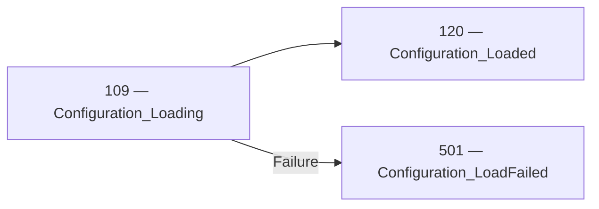
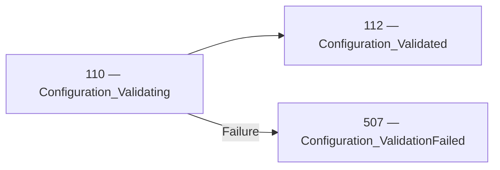

<!-- Generated by Generate-Events.ps1. Do not edit. -->

# Configuration events

Reports configuration loading attempts, validation attempts, and individual setting results\. Successful loading does not imply validation, and successful validation does not imply that a candidate has been applied\.

[All events](index.md) · [Category API reference](xref:Patware.Diagnostics.ApplicationEvents.ConfigurationEvents)

## Workflow guidance

These guides explain application workflows, including optional detail
events and failure paths beyond the beginning/completion relationships.

- [Configuration loading and validation](../architecture/CONFIGURATION-VALIDATION.md)

## Events

| EventId | Category | Method | EventClass | LogLevel |
| --- | --- | --- | --- | --- |
| [109](Event_109.md) | [Configuration](Category_Configuration.md) · [API](xref:Patware.Diagnostics.ApplicationEvents.ConfigurationEvents) | [Loading](xref:Patware.Diagnostics.ApplicationEvents.ConfigurationEvents.Loading%28System.String%2CSystem.String%2CSystem.String%29) | LowLevel | Information |
| [110](Event_110.md) | [Configuration](Category_Configuration.md) · [API](xref:Patware.Diagnostics.ApplicationEvents.ConfigurationEvents) | [Validating](xref:Patware.Diagnostics.ApplicationEvents.ConfigurationEvents.Validating%28System.String%2CSystem.String%29) | LowLevel | Information |
| [111](Event_111.md) | [Configuration](Category_Configuration.md) · [API](xref:Patware.Diagnostics.ApplicationEvents.ConfigurationEvents) | [ValueIsValid](xref:Patware.Diagnostics.ApplicationEvents.ConfigurationEvents.ValueIsValid%28System.String%2CSystem.String%2CSystem.String%29) | LowLevel | Information |
| [112](Event_112.md) | [Configuration](Category_Configuration.md) · [API](xref:Patware.Diagnostics.ApplicationEvents.ConfigurationEvents) | [Validated](xref:Patware.Diagnostics.ApplicationEvents.ConfigurationEvents.Validated%28System.String%2CSystem.String%29) | LowLevel | Information |
| [120](Event_120.md) | [Configuration](Category_Configuration.md) · [API](xref:Patware.Diagnostics.ApplicationEvents.ConfigurationEvents) | [Loaded](xref:Patware.Diagnostics.ApplicationEvents.ConfigurationEvents.Loaded%28System.String%2CSystem.String%2CSystem.String%29) | LowLevel | Information |
| [501](Event_501.md) | [Configuration](Category_Configuration.md) · [API](xref:Patware.Diagnostics.ApplicationEvents.ConfigurationEvents) | [LoadFailed](xref:Patware.Diagnostics.ApplicationEvents.ConfigurationEvents.LoadFailed%28System.String%2CSystem.String%2CSystem.String%2CSystem.String%2CSystem.Exception%29) | UnrecoverableWarning | Warning |
| [506](Event_506.md) | [Configuration](Category_Configuration.md) · [API](xref:Patware.Diagnostics.ApplicationEvents.ConfigurationEvents) | [ValueIsInvalid](xref:Patware.Diagnostics.ApplicationEvents.ConfigurationEvents.ValueIsInvalid%28System.String%2CSystem.String%2CSystem.String%2CSystem.String%29) | UnrecoverableWarning | Warning |
| [507](Event_507.md) | [Configuration](Category_Configuration.md) · [API](xref:Patware.Diagnostics.ApplicationEvents.ConfigurationEvents) | [ValidationFailed](xref:Patware.Diagnostics.ApplicationEvents.ConfigurationEvents.ValidationFailed%28System.String%2CSystem.String%2CSystem.String%29) | UnrecoverableWarning | Warning |

## Beginning and completion relationships

These diagrams show the beginning, completion, and failure outcomes
explicitly declared in the catalog. Optional detail events and other
category events may not participate.

### 109 — 120

- Beginning: [109 — Configuration\_Loading](Event_109.md) · [API](xref:Patware.Diagnostics.ApplicationEvents.ConfigurationEvents.Loading%28System.String%2CSystem.String%2CSystem.String%29)
- Completion: [120 — Configuration\_Loaded](Event_120.md) · [API](xref:Patware.Diagnostics.ApplicationEvents.ConfigurationEvents.Loaded%28System.String%2CSystem.String%2CSystem.String%29)
- Failure: [501 — Configuration\_LoadFailed](Event_501.md) · [API](xref:Patware.Diagnostics.ApplicationEvents.ConfigurationEvents.LoadFailed%28System.String%2CSystem.String%2CSystem.String%2CSystem.String%2CSystem.Exception%29)

### 110 — 112

- Beginning: [110 — Configuration\_Validating](Event_110.md) · [API](xref:Patware.Diagnostics.ApplicationEvents.ConfigurationEvents.Validating%28System.String%2CSystem.String%29)
- Completion: [112 — Configuration\_Validated](Event_112.md) · [API](xref:Patware.Diagnostics.ApplicationEvents.ConfigurationEvents.Validated%28System.String%2CSystem.String%29)
- Failure: [507 — Configuration\_ValidationFailed](Event_507.md) · [API](xref:Patware.Diagnostics.ApplicationEvents.ConfigurationEvents.ValidationFailed%28System.String%2CSystem.String%2CSystem.String%29)

## Lifecycle sequences

No lifecycle sequences are currently defined for this category.

Complete relationships are shown when any participating event belongs to this
category. Events from other categories remain visible to preserve the flow.
Sequences describe expected progression, not a guarantee that every record
will be emitted or retained.
