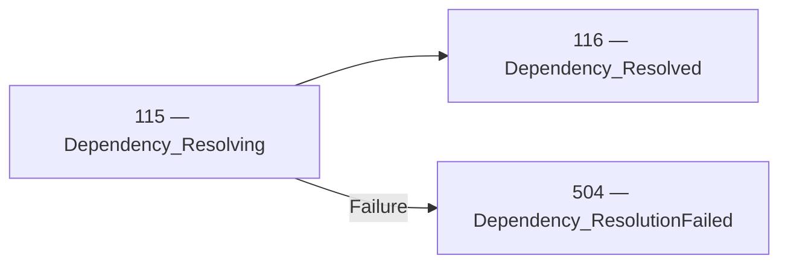

<!-- Generated by Generate-Events.ps1. Do not edit. -->

# Dependency events

Reports failures to locate, load, or construct application components\. Resolution outcomes do not automatically determine application mode\.

[All events](index.md) · [Category API reference](xref:Patware.Diagnostics.ApplicationEvents.DependencyEvents)

## Workflow guidance

These guides explain application workflows, including optional detail
events and failure paths beyond the beginning/completion relationships.

- [Dependency resolution](../architecture/DEPENDENCY-RESOLUTION.md)

## Events

| EventId | Category | Method | EventClass | LogLevel |
| --- | --- | --- | --- | --- |
| [115](Event_115.md) | [Dependency](Category_Dependency.md) · [API](xref:Patware.Diagnostics.ApplicationEvents.DependencyEvents) | [Resolving](xref:Patware.Diagnostics.ApplicationEvents.DependencyEvents.Resolving%28System.String%2CSystem.String%2CSystem.String%29) | LowLevel | Information |
| [116](Event_116.md) | [Dependency](Category_Dependency.md) · [API](xref:Patware.Diagnostics.ApplicationEvents.DependencyEvents) | [Resolved](xref:Patware.Diagnostics.ApplicationEvents.DependencyEvents.Resolved%28System.String%2CSystem.String%2CSystem.String%29) | LowLevel | Information |
| [504](Event_504.md) | [Dependency](Category_Dependency.md) · [API](xref:Patware.Diagnostics.ApplicationEvents.DependencyEvents) | [ResolutionFailed](xref:Patware.Diagnostics.ApplicationEvents.DependencyEvents.ResolutionFailed%28System.String%2CSystem.String%2CSystem.String%2CSystem.String%2CSystem.Exception%29) | UnrecoverableWarning | Warning |

## Beginning and completion relationships

These diagrams show the beginning, completion, and failure outcomes
explicitly declared in the catalog. Optional detail events and other
category events may not participate.

### 115 — 116

- Beginning: [115 — Dependency\_Resolving](Event_115.md) · [API](xref:Patware.Diagnostics.ApplicationEvents.DependencyEvents.Resolving%28System.String%2CSystem.String%2CSystem.String%29)
- Completion: [116 — Dependency\_Resolved](Event_116.md) · [API](xref:Patware.Diagnostics.ApplicationEvents.DependencyEvents.Resolved%28System.String%2CSystem.String%2CSystem.String%29)
- Failure: [504 — Dependency\_ResolutionFailed](Event_504.md) · [API](xref:Patware.Diagnostics.ApplicationEvents.DependencyEvents.ResolutionFailed%28System.String%2CSystem.String%2CSystem.String%2CSystem.String%2CSystem.Exception%29)

## Lifecycle sequences

No lifecycle sequences are currently defined for this category.

Complete relationships are shown when any participating event belongs to this
category. Events from other categories remain visible to preserve the flow.
Sequences describe expected progression, not a guarantee that every record
will be emitted or retained.
