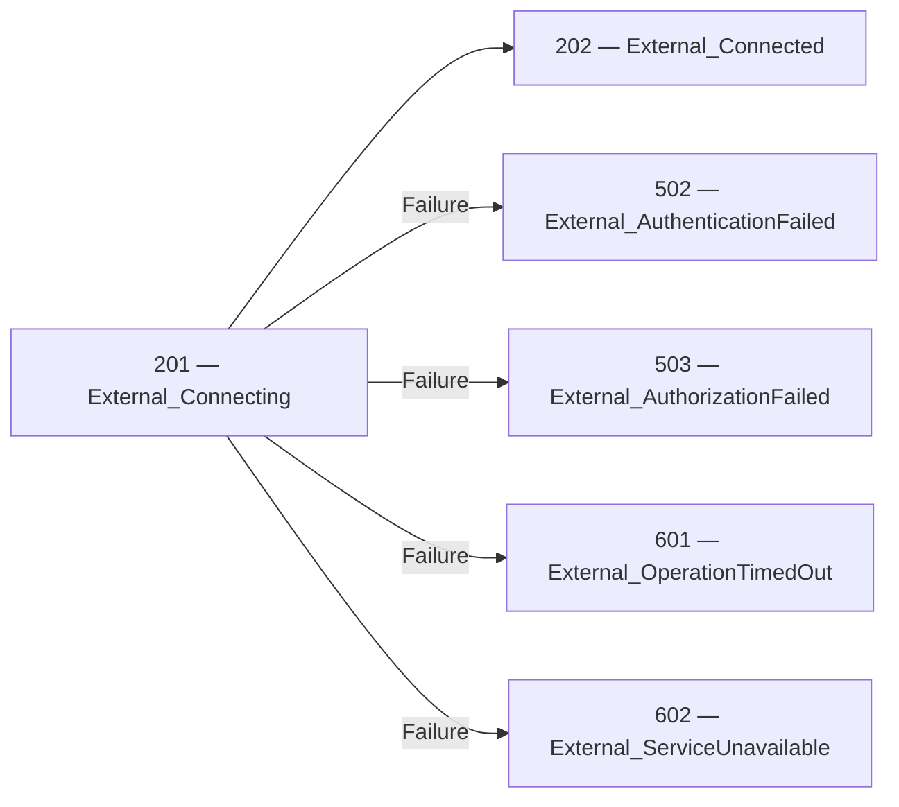
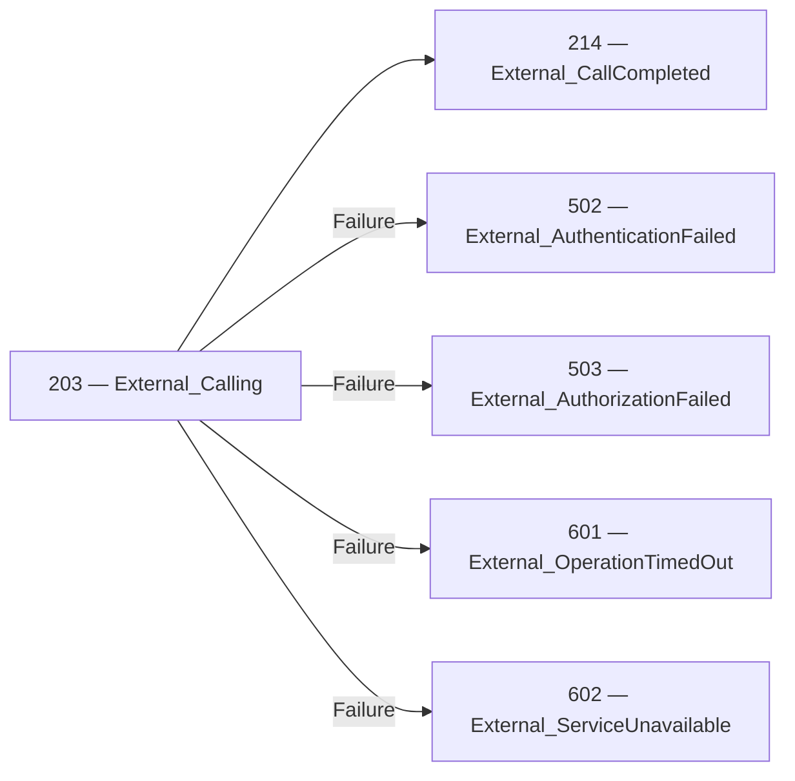

<!-- Generated by Generate-Events.ps1. Do not edit. -->

# External events

Reports operations involving external dependencies\. Operation outcomes do not automatically determine the application&#39;s operating mode\.

[All events](index.md) · [Category API reference](xref:Patware.Diagnostics.ApplicationEvents.ExternalEvents)

## Events

| EventId | Category | Method | EventClass | LogLevel |
| --- | --- | --- | --- | --- |
| [201](Event_201.md) | [External](Category_External.md) · [API](xref:Patware.Diagnostics.ApplicationEvents.ExternalEvents) | [Connecting](xref:Patware.Diagnostics.ApplicationEvents.ExternalEvents.Connecting%28System.String%2CSystem.String%2CSystem.String%29) | OperationalInformation | Information |
| [202](Event_202.md) | [External](Category_External.md) · [API](xref:Patware.Diagnostics.ApplicationEvents.ExternalEvents) | [Connected](xref:Patware.Diagnostics.ApplicationEvents.ExternalEvents.Connected%28System.String%2CSystem.String%2CSystem.String%29) | OperationalInformation | Information |
| [203](Event_203.md) | [External](Category_External.md) · [API](xref:Patware.Diagnostics.ApplicationEvents.ExternalEvents) | [Calling](xref:Patware.Diagnostics.ApplicationEvents.ExternalEvents.Calling%28System.String%2CSystem.String%2CSystem.String%29) | OperationalInformation | Information |
| [214](Event_214.md) | [External](Category_External.md) · [API](xref:Patware.Diagnostics.ApplicationEvents.ExternalEvents) | [CallCompleted](xref:Patware.Diagnostics.ApplicationEvents.ExternalEvents.CallCompleted%28System.String%2CSystem.String%2CSystem.String%29) | OperationalInformation | Information |
| [502](Event_502.md) | [External](Category_External.md) · [API](xref:Patware.Diagnostics.ApplicationEvents.ExternalEvents) | [AuthenticationFailed](xref:Patware.Diagnostics.ApplicationEvents.ExternalEvents.AuthenticationFailed%28System.String%2CSystem.String%2CSystem.String%2CSystem.String%2CSystem.Exception%29) | UnrecoverableWarning | Warning |
| [503](Event_503.md) | [External](Category_External.md) · [API](xref:Patware.Diagnostics.ApplicationEvents.ExternalEvents) | [AuthorizationFailed](xref:Patware.Diagnostics.ApplicationEvents.ExternalEvents.AuthorizationFailed%28System.String%2CSystem.String%2CSystem.String%2CSystem.String%2CSystem.Exception%29) | UnrecoverableWarning | Warning |
| [601](Event_601.md) | [External](Category_External.md) · [API](xref:Patware.Diagnostics.ApplicationEvents.ExternalEvents) | [OperationTimedOut](xref:Patware.Diagnostics.ApplicationEvents.ExternalEvents.OperationTimedOut%28System.String%2CSystem.String%2CSystem.String%2CSystem.Double%2CSystem.Exception%29) | Exceptional | Error |
| [602](Event_602.md) | [External](Category_External.md) · [API](xref:Patware.Diagnostics.ApplicationEvents.ExternalEvents) | [ServiceUnavailable](xref:Patware.Diagnostics.ApplicationEvents.ExternalEvents.ServiceUnavailable%28System.String%2CSystem.String%2CSystem.String%2CSystem.String%2CSystem.Exception%29) | Exceptional | Error |

## Beginning and completion relationships

These diagrams show the beginning, completion, and failure outcomes
explicitly declared in the catalog. Optional detail events and other
category events may not participate.

### 201 — 202

- Beginning: [201 — External\_Connecting](Event_201.md) · [API](xref:Patware.Diagnostics.ApplicationEvents.ExternalEvents.Connecting%28System.String%2CSystem.String%2CSystem.String%29)
- Completion: [202 — External\_Connected](Event_202.md) · [API](xref:Patware.Diagnostics.ApplicationEvents.ExternalEvents.Connected%28System.String%2CSystem.String%2CSystem.String%29)
- Failure: [502 — External\_AuthenticationFailed](Event_502.md) · [API](xref:Patware.Diagnostics.ApplicationEvents.ExternalEvents.AuthenticationFailed%28System.String%2CSystem.String%2CSystem.String%2CSystem.String%2CSystem.Exception%29)
- Failure: [503 — External\_AuthorizationFailed](Event_503.md) · [API](xref:Patware.Diagnostics.ApplicationEvents.ExternalEvents.AuthorizationFailed%28System.String%2CSystem.String%2CSystem.String%2CSystem.String%2CSystem.Exception%29)
- Failure: [601 — External\_OperationTimedOut](Event_601.md) · [API](xref:Patware.Diagnostics.ApplicationEvents.ExternalEvents.OperationTimedOut%28System.String%2CSystem.String%2CSystem.String%2CSystem.Double%2CSystem.Exception%29)
- Failure: [602 — External\_ServiceUnavailable](Event_602.md) · [API](xref:Patware.Diagnostics.ApplicationEvents.ExternalEvents.ServiceUnavailable%28System.String%2CSystem.String%2CSystem.String%2CSystem.String%2CSystem.Exception%29)

### 203 — 214

- Beginning: [203 — External\_Calling](Event_203.md) · [API](xref:Patware.Diagnostics.ApplicationEvents.ExternalEvents.Calling%28System.String%2CSystem.String%2CSystem.String%29)
- Completion: [214 — External\_CallCompleted](Event_214.md) · [API](xref:Patware.Diagnostics.ApplicationEvents.ExternalEvents.CallCompleted%28System.String%2CSystem.String%2CSystem.String%29)
- Failure: [502 — External\_AuthenticationFailed](Event_502.md) · [API](xref:Patware.Diagnostics.ApplicationEvents.ExternalEvents.AuthenticationFailed%28System.String%2CSystem.String%2CSystem.String%2CSystem.String%2CSystem.Exception%29)
- Failure: [503 — External\_AuthorizationFailed](Event_503.md) · [API](xref:Patware.Diagnostics.ApplicationEvents.ExternalEvents.AuthorizationFailed%28System.String%2CSystem.String%2CSystem.String%2CSystem.String%2CSystem.Exception%29)
- Failure: [601 — External\_OperationTimedOut](Event_601.md) · [API](xref:Patware.Diagnostics.ApplicationEvents.ExternalEvents.OperationTimedOut%28System.String%2CSystem.String%2CSystem.String%2CSystem.Double%2CSystem.Exception%29)
- Failure: [602 — External\_ServiceUnavailable](Event_602.md) · [API](xref:Patware.Diagnostics.ApplicationEvents.ExternalEvents.ServiceUnavailable%28System.String%2CSystem.String%2CSystem.String%2CSystem.String%2CSystem.Exception%29)

## Lifecycle sequences

No lifecycle sequences are currently defined for this category.

Complete relationships are shown when any participating event belongs to this
category. Events from other categories remain visible to preserve the flow.
Sequences describe expected progression, not a guarantee that every record
will be emitted or retained.
